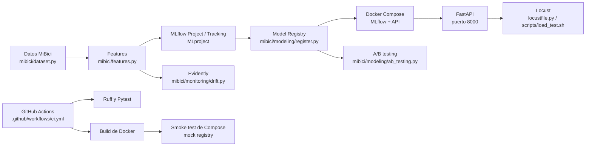
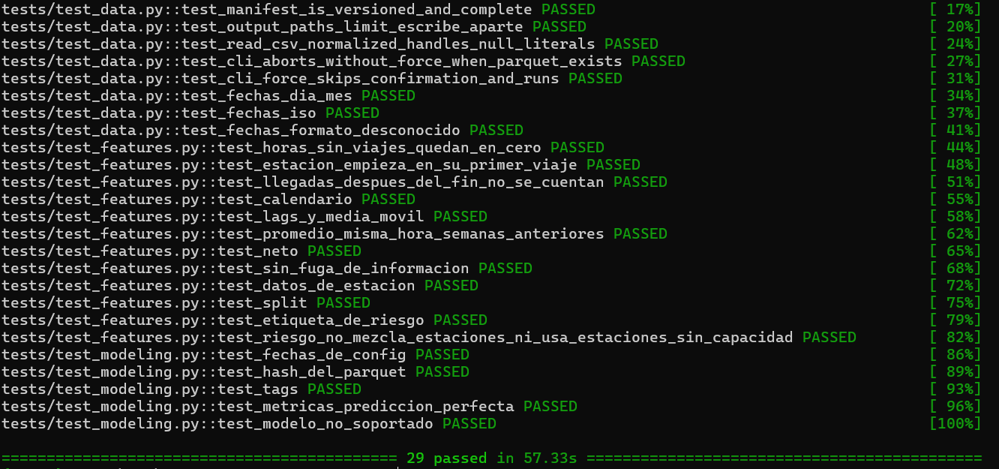
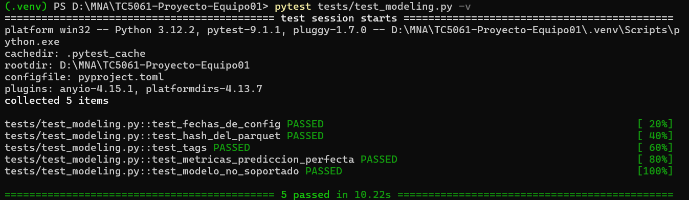
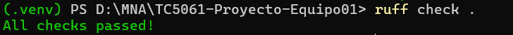
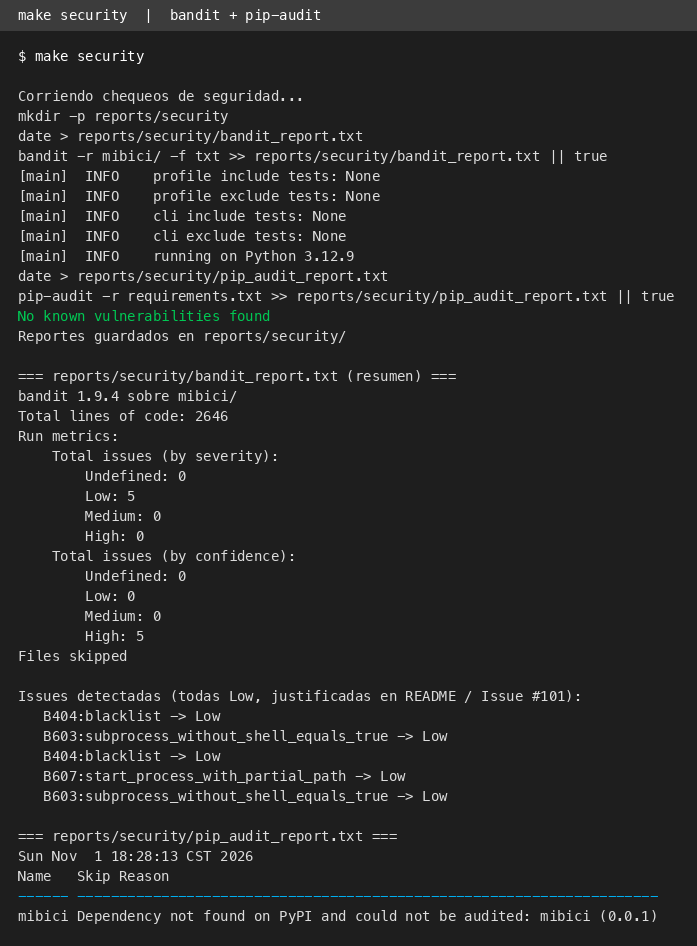
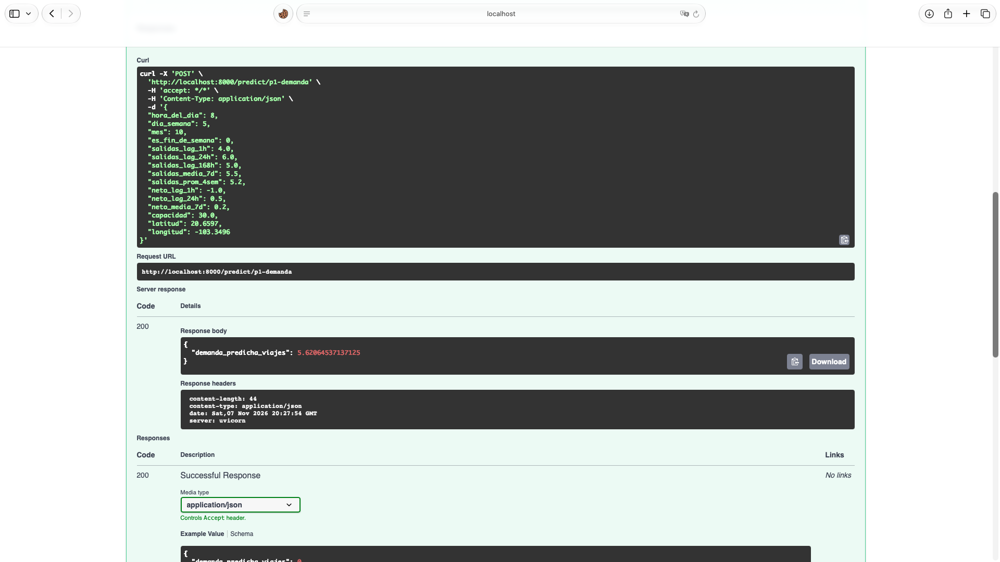

# TC5061 Proyecto MiBici Equipo 01

<a target="_blank" href="https://cookiecutter-data-science.drivendata.org/">
    
</a>
<a target="_blank" href="https://github.com/laloz60/TC5061-Proyecto-Equipo01/actions/workflows/ci.yml">
    
</a>

Regresión, clasificación y clustering sobre los viajes del sistema de bicicleta pública de Guadalajara (MiBici), con ingesta reproducible, partición temporal sin fuga y experimentos registrados en MLflow.

## Índice

- [Preguntas de investigación](#preguntas-de-investigación)
- [Datos](#datos)
- [Requisitos](#requisitos)
- [Instalación](#instalación)
- [Descarga de datos](#descarga-de-datos)
- [Features (P1 y P2)](#features-p1-y-p2)
- [P2 (Clasificación)](#p2-clasificación)
- [Experimentos (MLflow)](#experimentos-mlflow)
- [Arquitectura de extremo a extremo](#arquitectura-de-extremo-a-extremo)
- [Mapa de rúbrica](#mapa-de-rúbrica)
- [Pruebas de calidad y seguridad](#pruebas-de-calidad-y-seguridad)
- [Monitoreo, Drift y A/B Testing](#monitoreo-drift-y-ab-testing)
- [Buenas prácticas](#buenas-prácticas)
- [Despliegue de modelos (API REST con Docker)](#despliegue-de-modelos-api-rest-con-docker)
- [CI/CD, prueba de carga y costo por inferencia](#cicd-prueba-de-carga-y-costo-por-inferencia)
- [Entrega Final](#entrega-final)
- [Estructura del repositorio](#estructura-del-repositorio)
- [Flujo de trabajo Git](#flujo-de-trabajo-git)
- [Integrantes y responsabilidades](#integrantes-y-responsabilidades)

## Preguntas de investigación

|    | Pregunta | Tarea | Responsable |
|----|----------|-------|-------------|
| P1 | ¿Cuántos viajes se iniciarán en una estación en un periodo futuro? | Regresión | [@laloz60](https://github.com/laloz60) |
| P2 | ¿Una estación estará en riesgo de quedarse sin bicis/anclajes en un periodo futuro? | Clasificación | [@GemmaMartinez](https://github.com/GemmaMartinez) + [@smuciton](https://github.com/smuciton) |
| P3 | ¿Qué grupos de estaciones comparten patrones de uso y dónde se ubican? | Clustering | [@JesusTafolla](https://github.com/JesusTafolla) |

> **Reparto de P2:** es la tarea más pesada (diseño del proxy de riesgo + baseline de clasificación + evidencia MLflow), así que se divide en dos: **@smuciton** diseña y justifica el proxy de riesgo (#6) y **@GemmaMartinez** implementa el baseline de clasificación con su run en MLflow (#7).

## Datos

- **Fuente:** [datos abiertos de MiBici](https://mibici.net/es/datos-abiertos) — CSVs mensuales de viajes + nomenclatura de estaciones.
- **Cobertura:** 2023-05 a 2026-10 (**42 meses**, corte postpandemia decidido por el equipo: fin de la emergencia sanitaria COVID-19, mayo 2023) → **16,011,659 viajes** y **470 estaciones**.
- **Versionado:** solo `data/manifest.json` (hash SHA-256 de cada CSV, del Parquet unificado y de la nomenclatura). Los CSVs (~1.2 GB) y el Parquet (~330 MB) **no se suben al repositorio**; se regeneran con la ingesta y el manifiesto garantiza que sean idénticos.
- **Partición temporal sin fuga** (definida en `mibici/config.py`, nunca se mezclan meses futuros con el entrenamiento):

| Split  | Rango |
|--------|-------|
| train  | 2023-05 .. 2024-12 |
| val    | 2025-01 .. 2025-06 |
| test   | 2025-07 .. 2026-10 |

## Requisitos

- Python 3.12
- ~2 GB de espacio libre (CSVs + Parquet)
- [uv](https://docs.astral.sh/uv/getting-started/installation/): `mlflow run` lo usa para crear el entorno del `python_env.yaml` (Python 3.12.9 con versiones fijadas). Sin uv, MLflow necesita pyenv y falla con `'None' install 3.12.9`.
- Docker en ejecución para desplegar la API y MLflow mediante Compose.
- **Windows:** activar el *Modo de programador* (Configuración → Actualización y seguridad → Para programadores). `mlflow run` crea symlinks al instalar dependencias; sin ese permiso falla con `WinError 1314`.

## Instalación

```bash
git clone https://github.com/laloz60/TC5061-Proyecto-Equipo01.git
cd TC5061-Proyecto-Equipo01
python3.12 -m venv .venv         # PowerShell: python -m venv .venv
source .venv/bin/activate        # Windows: .venv\Scripts\activate
pip install -r requirements.txt  # instala también el paquete mibici (-e .)
```

## Descarga de datos

**Clon limpio (desde cero):** solo hace falta este comando. Descarga los 42 CSVs mensuales y la nomenclatura de estaciones (~1.2 GB) y los unifica en un Parquet:

```bash
python -m mibici.dataset
```

> Si vas a reproducir la entrega con `mlflow run` (ver [Reproducir con `mlflow run`](#reproducir-con-mlflow-run)), el entry point `ingest` ya ejecuta este mismo paso; no hace falta correrlo aparte.

**Opcionales** (no se necesitan en un clon limpio):

| Comando | Cuándo usarlo |
|---------|---------------|
| `python -m mibici.dataset --skip-download` | Ya tienes los CSVs en `data/raw/csv/` y solo quieres volver a unificarlos (p. ej. después de un cambio en la normalización). Falla si falta algún CSV. |
| `python -m mibici.dataset --force` | El Parquet unificado ya existe y quieres regenerarlo sin que se detenga a preguntar `¿Continuar?`. Los CSVs que ya están descargados se reutilizan. |
| `python -m mibici.dataset --limit 2` | Prueba rápida con solo 2 meses, para revisar que la ingesta funciona sin descargar todo. Escribe sus salidas aparte y no toca el Parquet ni el manifiesto completos. |

Salidas:

```
data/raw/mibici_viajes_2023_05_a_2026_10.parquet   # Parquet unificado (no versionado)
data/raw/nomenclatura_estaciones.parquet           # 470 estaciones: capacidad, lat/lon
data/manifest.json                                 # versionado: totales + SHA-256
```

Con `--limit` los archivos de prueba salen en `data/raw/mibici_viajes_limit.parquet` y `data/manifest_limit.json`: no se versionan y no reemplazan a los de arriba, así que el manifiesto completo solo lo escribe la ingesta completa.

Verificación de que tus datos son idénticos a los del equipo:

```bash
pytest            # pruebas de ingesta, manifiesto y features
```

Si `pytest` falla con `assert 15376153 == 15376127` en `test_unified_parquet_exists_and_is_non_empty`, no es un error del código: MiBici actualizó el CSV de 2023-05 después de que se generó el manifiesto versionado, así que tu descarga ya no coincide con él. Para validar tu entorno con los datos que descargaste:

```bash
python -m mibici.dataset --skip-download --force   # regenera el manifiesto local con tus datos (~1.5 min, sin volver a descargar)
pytest                                             # ahora deben pasar las 84 pruebas
git restore data/manifest.json                     # no commitees el manifiesto regenerado
```

En ese caso `pytest` confirma que la ingesta es consistente (Parquet, manifiesto y hashes cuadran) y que features y modelos funcionan, pero ya no que tus datos sean idénticos a los del equipo.

## Features (P1 y P2)

```bash
python -m mibici.features
```

Genera `data/processed/features_estacion_hora.parquet` con una fila por estación y hora: salidas, llegadas, variables de calendario, lags, promedios y capacidad de la estación. Los lags y promedios solo usan horas anteriores.

## P2 (Clasificación)

Para ejecutar el entrenamiento de los modelos de clasificación y registrar los experimentos y artefactos en MLflow, utiliza los siguientes comandos:

```bash
python -m mibici.modeling.train p2 --model-name dummy
python -m mibici.modeling.train p2 --model-name logreg
```
Esta etapa evalúa y predice si una estación se encuentra en riesgo de desabastecimiento de bicicletas. Mediante 2 modelos, depende de cual seleccionemos.
1. **Modelo Baseline (`dummy`):** Clasificador por defecto que establece el rendimiento mínimo de referencia utilizando clases mayoritarias.
2. **Modelo Candidato (`logreg`):** Modelo basado en Regresión Logística, diseñado para capturar relaciones lineales.

## Experimentos (MLflow)

### Servidor de tracking

El Model Registry necesita un almacenamiento respaldado por base de datos, así que el tracking se levanta con un servidor local sobre SQLite. Lánzalo **desde la raíz del repo** (ahí viven `mlflow.db` y `mlruns/`):

```bash
mlflow server --backend-store-uri sqlite:///mlflow.db --artifacts-destination ./mlruns --port 5000
# UI en http://127.0.0.1:5000
```

`--artifacts-destination ./mlruns` hace que el servidor sirva los artefactos por HTTP (`mlflow-artifacts:/`). Para correr en el host no hace falta, pero el contenedor sí lo necesita para descargar los modelos (ver [Conexión del contenedor con MLflow](#conexión-del-contenedor-con-mlflow)).


En otra terminal (o antes de lanzar cualquier corrida), apunta la variable de entorno al servidor para que todos los runs se registren ahí:

```bash
export MLFLOW_TRACKING_URI="http://127.0.0.1:5000"      # bash / macOS / Linux / Git Bash
```
```powershell
$env:MLFLOW_TRACKING_URI = "http://127.0.0.1:5000"     # PowerShell
```
En CMD, sin espacios ni comillas (CMD guarda en la variable todo lo que va después del `=`, incluido un espacio al final):

```cmd
set MLFLOW_TRACKING_URI=http://127.0.0.1:5000
echo [%MLFLOW_TRACKING_URI%]
```

El `echo` debe mostrar `[http://127.0.0.1:5000]`, con el `]` pegado al `5000`. Si aparece `[http://127.0.0.1:5000 ]`, la variable quedó con un espacio y `mlflow run` falla con `Invalid url: http://127.0.0.1:5000 /api/...`: vuelve a escribir el `set`.

La variable solo vive en la terminal donde se definió: los `mlflow run` deben lanzarse desde esa misma terminal. Puedes persistirla en `.env` (no se versiona) para no repetirla en cada sesión. Todas las corridas de esta entrega se lanzan con `mlflow run`, no desde un notebook.

> `mlflow.db` y `mlruns/` **no se versionan** (están en `.gitignore`, junto con `mlartifacts/`, los datos MiBici y los modelos serializados). En un clon nuevo el tracking arranca vacío, así que los runs se regeneran con los comandos de esta sección (las capturas de evidencia están en `reports/figures/mlflow_evidencia/`).

### Reproducir con `mlflow run`

Con el servidor arriba y `MLFLOW_TRACKING_URI` definida, desde la raíz del repo y en este orden. `--experiment-name` va siempre, para que los runs no caigan en `Default`; `--env-manager uv` crea el entorno aislado del `python_env.yaml` (la primera vez tarda ~1 min, después se reutiliza).

```bash
# 1. Datos y features
mlflow run . --experiment-name mibici-equipo01 --env-manager uv -e ingest              # macOS / Linux
mlflow run . --experiment-name mibici-equipo01 --env-manager uv -e ingest -P limit=0   # Windows
mlflow run . --experiment-name mibici-equipo01 --env-manager uv -e features

# 2. Baselines
mlflow run . --experiment-name mibici-equipo01 --env-manager uv -e train -P question=p1 -P model=regla
mlflow run . --experiment-name mibici-equipo01 --env-manager uv -e train -P question=p2 -P model=dummy
mlflow run . --experiment-name mibici-equipo01 --env-manager uv -e train -P question=p3 -P model=random

# 3. Modelo elegido de cada pregunta
mlflow run . --experiment-name mibici-equipo01 --env-manager uv -e train -P question=p1 -P model=rf -P n_estimators=300
mlflow run . --experiment-name mibici-equipo01 --env-manager uv -e train -P question=p2 -P model=logreg
mlflow run . --experiment-name mibici-equipo01 --env-manager uv -e train -P question=p3 -P model=k-means++ -P n_init=10

# 4. Model Registry
mlflow run . --experiment-name mibici-equipo01 --env-manager uv -e register
```

Valores de `model` por pregunta (vacío = baseline): p1 `regla` | `ridge` | `rf` · p2 `dummy` | `logreg` · p3 `random` | `k-means++`. Los parámetros completos de cada entry point están en el `MLproject`; los defaults (rutas, fechas, semilla) viven en `mibici/config.py`.

Notas:

- **`-P limit=0` en la ingesta (solo Windows)** significa "sin límite". En Windows, el default vacío llega como `""` y la ingesta falla con `Invalid value for '--limit'`; en macOS/Linux no hace falta.
- **Re-ejecutar la ingesta** cuando el Parquet ya existe: agrega `-P force=true`, o se detiene a preguntar `¿Continuar?`. Para no volver a descargar los CSV: `-P skip_download=true`.
- **`features` es obligatorio** antes de entrenar P1 y P2. Sus runs (y los de `ingest`) no registran métricas ni parámetros: solo dejan trazabilidad de commit y entry point.
- **Tiempos de referencia** (Windows, conexión doméstica): ingesta completa ~7.5 min (descarga ~6 min), features ~1 min, P2 `logreg` ~4.5 min, P3 <1 min.
- **Datos de la fuente:** MiBici puede actualizar CSV ya publicados. Al 22 oct 2026, el de 2023-05 trae 26 viajes más que el registrado en `data/manifest.json` (15,376,153 vs 15,376,127 en total), así que una descarga nueva produce otros hashes y `pytest` marca esa diferencia (ver [Descarga de datos](#descarga-de-datos) para validar con tus datos). El manifiesto versionado es la referencia del equipo: **no lo commitees al re-ejecutar la ingesta** (`git restore data/manifest.json`).

La salida completa de estos comandos en un clon limpio (comando, respuesta del log y resultado de cada paso) está en [`reports/validacion_clon_limpio_issue62.md`](reports/validacion_clon_limpio_issue62.md).

La comparación de baseline contra candidato de cada pregunta está en [`reports/baseline_vs_candidato.md`](reports/baseline_vs_candidato.md).

### Model Registry

`mlflow run . -e register` (`mibici/modeling/register.py`) registra el mejor run de cada pregunta según su métrica de **validación** (la selección no mira test; esa ventana queda solo para el reporte final):

| Pregunta | Modelo | Versión y alias | Run de origen | Métrica de selección |
|---|---|---|---|---|
| P1 | `mibici-equipo01-p1-demanda` | v2 `@champion` | `p1-candidate-rf-n200` (`c8ccdd71…`) | `val_mae = 0.8075` |
| P2 | `mibici-equipo01-p2-riesgo` | v2 `@champion` | `P2-parent-search-logreg`, C=0.1 (`1cd16f9f…`) | `val_roc_auc = 0.8292` |
| P3 | `mibici-equipo01-p3-grupos` | v2 `@champion` | `p3-candidate-k3` (`398be41f…`) | `val_silhouette_score = 0.4026` |


- Busca primero entre las corridas con tag `stage_of_work=candidate`; si ninguna tiene modelo logueado, usa todas las corridas de la pregunta. Las corridas sin la métrica de validación se omiten, porque no son comparables.
- Cada versión lleva en su descripción el linaje: run de origen, commit y hashes del manifiesto y del Parquet.
- No registra dos veces el mismo run: re-ejecutarlo es seguro y solo completa descripción, tags y alias.
- **Estado de cada versión** (tag `stage`):

  | Tag `stage` | Alias | Significado |
  |---|---|---|
  | `production` | `@champion` | La versión que sirve la API. Lleva también `pregunta`, `metrica_seleccion` y `valor_metrica`. |
  | `evaluation` | `@ab-candidate` | Retador del A/B test de P2 (ver [Monitoreo](#monitoreo-drift-y-ab-testing-actividad-9)); no sirve tráfico. |
  | `archived` | — | Versión que dejó de ser `@champion`; se conserva como historial. |

- **Ciclo de vida:** la versión en producción se marca con el alias `@champion` y se carga por nombre:

  ```python
  import mlflow
  modelo = mlflow.pyfunc.load_model("models:/mibici-equipo01-p2-riesgo@champion")
  ```

P2 v4 tiene el alias `@ab-candidate` y el tag `stage=evaluation`; no sirve tráfico de producción. Las versiones `@champion` tienen `stage=production` y los tags `pregunta`, `metrica_seleccion` y `valor_metrica`.

`mlflow.db` no se versiona, así que las versiones y tags corresponden al Registry real verificado, no a una base SQLite que se descargue con el repositorio. Para comprobar un Registry local:

```bash
python scripts/verificar_registry.py
sqlite3 mlflow.db "SELECT name, version, key, value FROM model_version_tags ORDER BY name, version;"
```

La evidencia de la corrida y sus verificaciones está en [`reports/registry_issue191.md`](reports/registry_issue191.md).

#### Ubicación del registry y modelos desplegados

El Registry guarda sus metadatos en `mlflow.db` y los artefactos en `mlruns/`; ninguno de los dos se versiona. En Docker Compose, MLflow escucha en el puerto `5000` dentro de la red y se publica en el host en `5001`. La API se conecta a `http://mlflow:5000` y carga al iniciar los tres modelos `@champion`.

Modelos que sirve la API:

| Pregunta | Modelo registrado | Versión `@champion` | Run de origen | Endpoint |
|---|---|---|---|---|
| P1 | `mibici-equipo01-p1-demanda` | 2 | `p1-candidate-rf-n200`, val_mae 0.8075 (`c8ccdd71…`) | `POST /predict/p1-demanda` |
| P2 | `mibici-equipo01-p2-riesgo` | 2 | `P2-parent-search-logreg`, C=0.1, val_roc_auc 0.8292 (`1cd16f9f…`) | `POST /predict/p2-riesgo` |
| P3 | `mibici-equipo01-p3-grupos` | 2 | `p3-candidate-k3`, val_silhouette 0.4026 (`398be41f…`) | `POST /predict/p3-clustering` |

La carga la hace `mibici/api/registry.py` (`load_champion`) en dos pasos:

P2 v4 tiene el alias `@ab-candidate` y `stage=evaluation`; no sirve tráfico de producción. Las versiones `@champion` tienen `stage=production`. La evidencia del registro está en [`reports/registry_issue191.md`](reports/registry_issue191.md).

Para revisar las versiones y aliases de un Registry local:

```bash
python scripts/verificar_registry.py
```

La salida del registro, el estado de cada versión y la prueba de la API con los `@champion` están en [`reports/registry_issue191.md`](reports/registry_issue191.md).

> `mlflow.db` no se versiona: esta tabla describe el registry real de este repositorio, el mismo que monta Docker Compose. Las tres versiones `@champion` (v2) llevan los tags `stage=production`, `pregunta`, `metrica_seleccion` y `valor_metrica`; P2 v4 es el `@ab-candidate` con `stage=evaluation` (no sirve tráfico); el resto de versiones (P1/P2/P3 v1 y P2 v3) es historial sin alias. El estado se re-genera con `mlflow run . --experiment-name mibici-equipo01 --env-manager uv -e register` y se audita con `sqlite3 mlflow.db "SELECT name, version, key, value FROM model_version_tags;"` (evidencia en [`reports/registry_issue191.md`](reports/registry_issue191.md)).

### Ejecución directa (sin MLflow Project)

Útil para desarrollo. Para reproducir la entrega usa los comandos `mlflow run` de arriba. Las búsquedas con nested runs de P1 y P3 hoy solo se lanzan así: `python -m mibici.modeling.train p1-search` y `python -m mibici.modeling.train p3-search`.

- Experimento: `mibici-equipo01`
- Convención de runs: nombre `P1-baseline`, `P2-baseline-logreg`, `P3-kmeans`; tags `equipo=01`, `pregunta=P1|P2|P3`, `commit=<sha>`; params incluyen rango de fechas y hash del manifiesto; al menos 1 artefacto por run.
- Entrenamiento: `python -m mibici.modeling.train`. Antes de P1 y P2 correr `python -m mibici.features` para generar las features.
- **P1 (Regresión)** — baseline `regla` (no entrena) y candidatos `ridge` y `rf`:
  ```bash
  python -m mibici.modeling.train p1 --model regla
  python -m mibici.modeling.train p1 --model ridge
  python -m mibici.modeling.train p1 --model rf
  ```
- **P2 (Clasificación)** — baseline `dummy` y candidato `logreg`:
  ```bash
  python -m mibici.modeling.train p2 --model-name dummy
  python -m mibici.modeling.train p2 --model-name logreg
  ```
- **P3 (Clustering)** — baseline (K-Means con inicialización aleatoria). El pipeline completo es de tres pasos:
  ```bash
  python -m mibici.modeling.train p3    # entrena K-Means (k=5) y lo serializa en models/kmeans_p3.pkl
  python -m mibici.modeling.predict p3  # asigna clústeres y escribe reports/p3_evaluation_summary.txt
  python -m mibici.reportes_p3          # regenera el summary y las figuras de P3 desde los datos
  ```
  El tercer comando (`mibici/reportes_p3`) reconstruye `reports/p3_evaluation_summary.txt`,
  `reports/figures/p3_distribucion_clusters.png` y `reports/figures/p3_mapa_geografico.png`
  sin depender de binarios versionados, así el reporte es reproducible en un clon limpio.

Las capturas de pantalla de los *runs*, artefactos y comparación de modelos se encuentran en:
```text
reports/figures/mlflow_evidencia/
```
## Arquitectura de extremo a extremo



Locust se ejecuta por separado contra una API disponible. No forma parte del pipeline de CI descrito arriba. El smoke test de CI usa el Registry simulado; el despliegue local con modelos reales requiere el Registry local preparado.

## Mapa de rúbrica

La tabla relaciona sus componentes con archivos y comandos que permiten comprobarlos.

| Evidencia | Archivo o comando |
|---|---|
| Organización del proyecto | `pyproject.toml`, `MLproject` y el árbol de carpetas de este README |
| Ingesta y manifiesto | `mibici/dataset.py`, `data/manifest.json`; `python -m mibici.dataset` |
| Ingeniería de características | `mibici/features.py`, `tests/test_features.py`; `python -m mibici.features` |
| Experimentos de MLflow | `MLproject`, `mibici/mlflow_entry.py`; `mlflow run . -e train ...` |
| Model Registry | `mibici/modeling/register.py`, `scripts/verificar_registry.py` |
| API y despliegue | `mibici/api/`, `Dockerfile`, `docker-compose.yml`; `make compose-up`, `make compose-test` |
| CI/CD | `.github/workflows/ci.yml`; Ruff, Pytest, build y smoke test de Compose |
| Prueba de carga | `locustfile.py`, `scripts/load_test.sh`; `bash scripts/load_test.sh A 1` |
| Drift y A/B | `mibici/monitoring/drift.py`, `mibici/modeling/ab_testing.py`; entry points `drift` y `ab_test` |

## Pruebas de calidad y seguridad
El proyecto incluye pruebas con `pytest`, validación de datos con `DeepChecks` y chequeos de seguridad (`bandit` + `pip-audit`).

**Estructura de `tests/`** (8 archivos, 84 pruebas)
- `tests/test_data.py` (12): datos de MiBici, validación de SHA-256 e integridad del parquet unificado, comportamiento del CLI y parsing de fechas. Incluye casos límite: header malformado de 2023-04, literales nulos y formato de fecha desconocido.
- `tests/test_features.py` (13): cálculo de features por estación y hora, lags, media móvil, calendario, split temporal y etiqueta de riesgo de P2. Cubre casos límite como horas sin viajes, estación que empieza en su primer viaje y llegadas fuera de la ventana. Incluye `test_sin_fuga_de_informacion`.
- `tests/test_modeling.py` (13): fechas de `config`, hash del parquet, tags de MLflow, métricas de regresión, selección por validación, silhouette de P3 y perfil de ventana. Casos límite: silhouette con una sola fila (`NaN`) y ventana de perfil vacía.
- `tests/test_reproducibilidad.py` (3): dos entrenamientos con la misma semilla dan las mismas predicciones y métricas; con semilla distinta cambian (control negativo); Ridge es estable entre corridas.
- `tests/test_register.py` (19): detección de modelo logueado, selección del mejor run por métrica de validación (omite corridas sin `val_*`), fallback a corridas previas, idempotencia, tags `stage=production`, archivado del champion anterior y `@ab-candidate` en evaluación.
- `tests/test_proxy_riesgo.py` (11): construcción de la tabla de riesgo de P2, sensibilidad al umbral, top de estaciones y plots. Casos límite: estación sin desbalance, estación inexistente en nomenclatura y corte `n` exacto.
- `tests/test_data_validation.py` (2): validación del esquema y de la corrida completa de DeepChecks (esta última corre solo con el entorno de validación creado).
- `tests/test_ab_testing.py` (17): A/B testing de P2: métricas, selección de umbral por F1, prueba de McNemar, tabla comparativa V2 − V1, veredicto de promoción, sensibilidad modelo × umbral y flujo completo que registra la V2 sin mover `@champion`.

**Comandos para ejecutar**
Ya estando en el entorno virtual, es necesario ejecutar

1. Pruebas unitarias `pytest`

  ```bash
pytest -v
  ```

Los casos se organizan de la siguiente forma:

- `tests/test_data.py`: ingesta, manifiesto, hashes, esquema y CLI.
- `tests/test_features.py`: cálculo de features, lags, split temporal y etiqueta de riesgo.
- `tests/test_modeling.py`: métricas, configuración y evaluación de modelos.
- `tests/test_reproducibilidad.py`: reproducibilidad de predicciones y métricas.
- `tests/test_register.py`: selección de modelos, aliases e idempotencia del registro.
- `tests/test_proxy_riesgo.py`: construcción y análisis del proxy de riesgo.
- `tests/test_data_validation.py`: esquema y validación de datos con DeepChecks.
- `tests/test_ab_testing.py`: métricas, prueba de McNemar y flujo A/B.

Captura de pantalla para verificar que se ejecute correctamente `reports\figures\evidencia_pruebas_calidad_seguridad\pytest`



2. Validación de datos con `DeepChecks`

Revisa tipos, valores faltantes, duplicados y drift entre train y test. Corre en un entorno aparte porque DeepChecks 0.19.1 no funciona con las versiones de scikit-learn y NumPy del proyecto.

  ```bash
make validation_env   # solo la primera vez
make validate
  ```

Sin `make`, en Windows:

  ```bash
uv venv --python 3.12 .venv-validacion
uv pip install --python .venv-validacion\Scripts\python.exe -r requirements-validation.txt
.venv-validacion\Scripts\python.exe -W ignore -m mibici.data_validation
  ```

La salida queda en `reports/data_validation/resumen.json`. Los hallazgos y las acciones tomadas están en [`reports/validacion_datos.md`](reports/validacion_datos.md).

**Resumen del último chequeo** (15,376,127 viajes, semilla 42, muestras de 200,000 filas):

| Chequeo | Resultado |
|---|---|
| Tipos de datos | `ok = True`, sin diferencias contra el esquema esperado |
| Valores faltantes | `genero` 104,981 (0.68%) · `anio_nacimiento` 7,773 (0.05%) · resto 0 |
| Duplicados | 758 filas exactas · 1,065 mismos viajes con otro `viaje_id` |
| DeepChecks (muestra) | sin tipos mezclados · 0.0% de filas duplicadas |
| Drift viajes (train vs test) | ninguna columna marcada · máx. `anio_nacimiento` 0.0788 (K-S) |
| Drift features (train vs test) | ninguna columna marcada · máx. `mes` 0.1832 (Cramer's V) |

El umbral de drift es 0.2 y ninguna columna lo alcanza. Las 758 filas duplicadas exactas ya se eliminan al generar las features.

Captura de la ejecución de `make validate` con DeepChecks, `reports\figures\evidencia_pruebas_calidad_seguridad\DeepChecks.png`


3. Análisis de calidad
  ```bash
ruff check .
  ```

Salida ejemplo
  ```bash
All checks passed!
  ```

Captura de pantalla para verificar que se ejecute correctamente `reports\figures\evidencia_pruebas_calidad_seguridad\ruff.png`


4. Chequeos de seguridad (`bandit` + `pip-audit`)
  ```bash
make security
  ```

Los reportes quedan en `reports/security/bandit_report.txt` y `reports/security/pip_audit_report.txt`.

Captura de la ejecución de `make security`, `reports\figures\evidencia_pruebas_calidad_seguridad\security.png`


### Ejecutar las comprobaciones agrupadas

```bash
make check-all
```

`make check-all` ejecuta las pruebas, la validación de datos y los chequeos de seguridad. Ruff se ejecuta por separado con `make lint`.

La configuración del pipeline de CI está en [`.github/workflows/ci.yml`](.github/workflows/ci.yml).

La preparación y protección de datos se documenta en [`docs/clean_doc.md`](docs/clean_doc.md).

### Comparación de Familias de Modelos

Explorarando múltiples algoritmos, el pipeline de entrenamiento ahora compara distintas familias de modelos utilizando *nested runs* en MLflow para cada pregunta de investigación:

- **P1 (Regresión):** Se compara el baseline (regla del promedio de la misma hora en las 4 semanas previas) contra `Ridge`, `RandomForestRegressor` y la nueva familia `GradientBoostingRegressor`.
- **P2 (Clasificación):** Se compara el baseline (`Dummy`) contra `LogisticRegression` y la nueva familia `RandomForestClassifier`.
- **P3 (Clustering):** Se compara el baseline (`KMeans` con inicialización aleatoria) contra `KMeans++` y la nueva familia `GaussianMixture`.

Para ejecutar las búsquedas de hiperparámetros y registrar los candidatos de estas nuevas familias en tu servidor local de MLflow, ejecuta:
```bash
python -m mibici.modeling.train p1-search
python -m mibici.modeling.train p2 --model-name rf
python -m mibici.modeling.train p3-search
```

## Monitoreo, Drift y A/B Testing

El proyecto incluye una capa de observabilidad para mantener vigentes los modelos: detecta cambios en los datos y evalúa nuevas versiones antes de promoverlas. El resultado integrado (drift, A/B y recomendación de Continuous Training) está en [`reports/reporte_actividad9.md`](reports/reporte_actividad9.md).

### 1. Reporte de Data Drift y Calidad (Evidently)

Compara la distribución y la calidad de los datos en dos periodos separados por fecha, para evitar fuga temporal y simular el entorno de producción:

- **Conjunto de Referencia (Train):** mayo 2023 a diciembre 2024. Es la ventana con la que se entrenaron los modelos vigentes (`config.TRAIN_END`), en un periodo postpandemia ya estabilizado.
- **Conjunto Actual (Test/Producción):** enero 2025 a octubre 2026. Periodo que el modelo no vio; muestra cómo cambian la movilidad y la operación de la red con el tiempo.

De cada periodo se toman 30,000 filas con `config.SEED` para que el reporte quepa en memoria y sea reproducible.

```bash
mlflow run . -e drift --env-manager=uv
```

Salida: [`reports/drift_report.html`](reports/drift_report.html) (reporte interactivo) y [`reports/drift_report.json`](reports/drift_report.json) (métricas por variable).

### 2. A/B Testing del modelo P2 (Riesgo)

Compara la versión vigente del modelo (`@champion`) contra una V2 reentrenada con la ventana extendida 2023-05 a 2025-06, registrada como nueva versión del mismo modelo con el alias `@ab-candidate`. El alias `champion` no se mueve.

Las dos versiones se evalúan sobre **el mismo conjunto**: el split `test` (2025-07 a 2026-09), con las mismas features, la misma etiqueta y la misma semilla. Se reportan ROC AUC, average precision, precisión, recall y F1 macro, y la diferencia se prueba con el test exacto de McNemar.

```bash
mlflow run . -e ab_test --env-manager=uv
```

El entry point entrena y registra la V2, y después compara las dos versiones (`python -m mibici.modeling.ab_testing run`). Requiere el servidor de MLflow levantado y la V1 registrada con el alias `@champion`. Salida: [`reports/ab_testing_p2.md`](reports/ab_testing_p2.md), [`reports/ab_testing_p2.csv`](reports/ab_testing_p2.csv) y las gráficas en [`reports/figures/ab_testing_p2/`](reports/figures/ab_testing_p2/).

> **No re-ejecutar `-e ab_test` sin acordarlo:** entrena y registra otra versión de P2 y mueve `@ab-candidate`. Los reportes versionados corresponden a la corrida documentada en [`reports/reporte_actividad9.md`](reports/reporte_actividad9.md).

### 3. Gobernanza y Model Card

La documentación consolidada de los tres modelos `@champion` (uso previsto, métricas de evaluación de P1/P2/P3, linaje alineado con el Model Registry, limitaciones y sesgos, política de drift/Continuous Training y perfil FinOps) se encuentra en [`docs/MODEL_CARD.md`](docs/MODEL_CARD.md).

## Buenas prácticas

- **Métricas**: se nombran con el conjunto donde se calculan, `<split>_<métrica>` — `test_rmse`, `test_roc_auc`, `test_silhouette_score` (ver `mibici/modeling/train.py`).
- **Notebooks**: convención CCDS `notebooks/<número>-<descripción>.ipynb` (p. ej. `1.0-iniciales-descripcion.ipynb`). Solo exploración: lo que se reutiliza baja a los módulos (`mibici/features.py`, `mibici/modeling/`). Sin datos personales de usuarios en las gráficas exportadas.
- **Credenciales y datos personales**: nunca se suben a MLflow ni al repo. Viven en `.env`, que está en `.gitignore`; los runs solo registran params y tags públicos.
- **Config centralizada**: rutas, cortes de fechas y `SEED` se leen de `mibici/config.py`, sin duplicarlos en `mibici/dataset.py` ni en `mibici/modeling/`.
- **`.gitignore`**: excluye los datos MiBici (`/data/*`, salvo `data/manifest.json`), `mlruns/`, `mlartifacts/`, `.env` y los modelos serializados (`models/*.pkl`, `models/*.joblib`, `models/*.onnx`, `models/*.bin`).
- **Versionado de datos**: `data/manifest.json` guarda el SHA-256 del parquet unificado y de la nomenclatura, con el total de viajes y estaciones. Es lo único de `data/` que entra al repo.
- **Limpieza y privacidad:** consulta la [preparación y protección de datos](docs/clean_doc.md).

## Despliegue de Modelos (API REST con Docker)

El servicio expone los modelos de Regresión (P1), Clasificación (P2) y Clustering (P3) del proyecto mediante una API REST construida con **FastAPI** y validación de las entradas y las salidas con **Pydantic**. Los modelos **no se incluyen en la imagen**: a través de la variable `MLFLOW_TRACKING_URI` el contenedor se conecta al servidor local de MLflow, carga los modelos en memoria RAM al iniciar y los sirve con el alias `@champion`, de modo que siempre se entrega la última versión sin reconstruir la imagen OCI.

Para levantar el sistema

```bash
docker compose up -d --build --wait
docker compose ps
bash scripts/test_api.sh
```

`--wait` espera a que los servicios estén saludables antes de ejecutar el script. Si necesitas crear `.env`, hazlo solo cuando no exista: el archivo es opcional para Compose y copiar la plantilla encima de un `.env` existente lo reemplazaría.

```bash
# Opcional: crear .env solo si todavía no existe
[ -f .env ] || cp .env.example .env
```

También puedes iniciar y probar en una sola línea:

```bash
docker compose up -d --build --wait && bash scripts/test_api.sh
```

| Verificación | Resultado |
|---|---|
| `docker compose up -d --build --wait` | Servicios saludables en 14 s |
| `scripts/test_api.sh` | 5/5: health, P1, P2, P3 y payload inválido |
| `pytest tests/` | 99 pruebas aprobadas |
| CI | Run [45658015658](https://github.com/laloz60/TC5061-Proyecto-Equipo01/actions/runs/45658015658) exitoso |
| Swagger `/docs` | HTTP 200 |

Después de alinear los tags del Registry real, la ejecución reportada obtuvo `102 passed`.

#### Requisitos

- Docker instalado y en ejecución (el `Dockerfile` es estándar OCI: funciona igual con Podman).
- Servidor MLflow accesible desde el contenedor (ver [Conexión del contenedor con MLflow](#conexión-del-contenedor-con-mlflow)).
- Modelos registrados en MLflow con el alias `@champion`.

### Construir la imagen

Desde la raíz del repositorio:

```bash
docker build -t mibici-api:latest .
```

O, con el target del `Makefile` (mismo resultado, automatizado):

```bash
make docker-build   # Construye la imagen mibici-api:latest
```

### Levantar el contenedor

Primero levanta el servidor de MLflow (ver [Experimentos](#experimentos-mlflow) y [Conexión del contenedor con MLflow](#conexión-del-contenedor-con-mlflow)). Después:

```bash
docker run -d \
  -p 8000:8000 \
  -e MLFLOW_TRACKING_URI=http://host.docker.internal:5000 \
  --name mibici-service \
  mibici-api:latest
```

En Linux, agrega `--add-host` al comando (en Docker Desktop para macOS y Windows el hostname ya resuelve y el flag no estorba):

```bash
docker run -d \
  --add-host=host.docker.internal:host-gateway \
  -p 8000:8000 \
  -e MLFLOW_TRACKING_URI=http://host.docker.internal:5000 \
  --name mibici-service \
  mibici-api:latest
```

Equivalente con el `Makefile` (contenedor llamado `mibici-api`, en primer plano):

```bash
make docker-run
```

La documentación interactiva de la API queda en [http://localhost:8000/docs](http://localhost:8000/docs) y el chequeo de estado responde en `http://localhost:8000/health`.

### Conexión del contenedor con MLflow

El contenedor llega al servidor MLflow de la máquina anfitriona por el hostname `host.docker.internal`. Para que funcione, hacen falta tres cosas:

| Dónde | Qué | Para qué |
|---|---|---|
| Servidor (host) | `MLFLOW_SERVER_ALLOWED_HOSTS="localhost:5000,127.0.0.1:5000,host.docker.internal:5000"` | Sin ella MLflow rechaza el `Host` del contenedor (protección DNS rebinding) con `403 Invalid Host header` |
| Servidor (host) | `--artifacts-destination ./mlruns` | Sirve los artefactos por HTTP; el `artifact_uri` guardado es una ruta local del host que no existe dentro del contenedor |
| Contenedor | `MLFLOW_TRACKING_URI=http://host.docker.internal:5000` | Ya viene en el `Dockerfile`; se puede sobrescribir con `-e` |
| Contenedor (Linux) | `--add-host=host.docker.internal:host-gateway` | En Linux el hostname no existe por defecto; Docker Desktop (Windows/macOS) ya lo resuelve, y el flag no estorba |

Levantar el servidor:

```bash
# bash / macOS / Linux
MLFLOW_SERVER_ALLOWED_HOSTS="localhost:5000,127.0.0.1:5000,host.docker.internal:5000" \
  mlflow server --backend-store-uri sqlite:///mlflow.db --artifacts-destination ./mlruns --port 5000
```
```powershell
# PowerShell
$env:MLFLOW_SERVER_ALLOWED_HOSTS = "localhost:5000,127.0.0.1:5000,host.docker.internal:5000"
mlflow server --backend-store-uri sqlite:///mlflow.db --artifacts-destination ./mlruns --port 5000
```
```cmd
:: CMD (sin comillas ni espacios)
set MLFLOW_SERVER_ALLOWED_HOSTS=localhost:5000,127.0.0.1:5000,host.docker.internal:5000
mlflow server --backend-store-uri sqlite:///mlflow.db --artifacts-destination ./mlruns --port 5000
```

Verificar desde el contenedor que los tres modelos `@champion` se resuelven y cargan:

```bash
docker run --rm --add-host=host.docker.internal:host-gateway \
  -e MLFLOW_TRACKING_URI=http://host.docker.internal:5000 \
  --mount type=bind,source="$(pwd)/scripts",target=/app/scripts,readonly \
  mibici-api:latest python scripts/verificar_registry.py
```

Errores comunes:

| Síntoma | Causa | Solución |
|---|---|---|
| `403 Invalid Host header` | Falta `MLFLOW_SERVER_ALLOWED_HOSTS` | Reiniciar el servidor con la variable |
| `No such artifact: ''` o fallo al descargar | Servidor sin `--artifacts-destination` | Reiniciar el servidor con `--artifacts-destination ./mlruns` |
| `Connection refused` | Servidor apagado, o lanzado con `--host 127.0.0.1` en Linux | Levantarlo; en Linux usar `--host 0.0.0.0` |
| `403 Server: AirTunes` (macOS) | AirPlay ocupa el puerto 5000 | Apagar el receptor AirPlay o usar otro puerto |
| `"docker" no se reconoce` (Windows) | La terminal se abrió antes de instalar Docker Desktop | Reiniciar VS Code o la terminal |
| `403 Invalid Host header` en `http://localhost:5001` | Falta permitir el puerto publicado del host | Usa el `docker-compose.yml` actualizado, que incluye `localhost:5001` y `127.0.0.1:5001` |

**Alternativa evaluada: empaquetar el modelo en la imagen.** Consiste en descargar los artefactos del registry al construir la imagen y cargarlos desde disco, sin servidor MLflow en tiempo de ejecución.

- A favor: la imagen es autocontenida y arranca sin depender del host.
- En contra: cada versión nueva del modelo obliga a reconstruir la imagen, y se pierde la trazabilidad en vivo con el alias `@champion`.

Elegimos la carga dinámica porque promover un modelo en el registry basta para que el servicio lo tome con solo reiniciar el contenedor.

La evidencia de esta validación está en [`reports/api/evidencia_conexion_contenedor.md`](reports/api/evidencia_conexion_contenedor.md).

### Ejemplo de consumo de la API

Salida de `make docker-test` contra el contenedor en marcha:
```bash
== 1. Health check ==
{"status":"healthy","modelos_cargados":["p1","p2","p3"]}   HTTP 200

== 2. P1 ==
{"demanda_predicha_viajes":5.620645371371248}   HTTP 200

== 3. P2 ==
{"riesgo_desabasto_o_saturacion":1,"probabilidad_riesgo":0.7448901989148815}   HTTP 200

== 4. P3 ==
{"cluster_asignado":2}   HTTP 200

== 5. Payload invalido ==   HTTP 422
```

Consulta el [detalle de la prueba](reports/api/evidencia_actividad8_contenedor.md).



### Estrategia de despliegue

Se eligió inferencia en tiempo real mediante una API REST síncrona. Cada petición se procesa al recibirse, en lugar de agrupar solicitudes para ejecutarlas por lotes.

### Ubicación del Model Registry

El servicio consulta el Model Registry de MLflow mediante `MLFLOW_TRACKING_URI`. Al iniciar, carga los modelos registrados con el alias `@champion`; por ello, actualizar el modelo en el registry y reiniciar el contenedor permite servir la nueva versión sin reconstruir la imagen.

## CI/CD, Prueba de carga y Costo por inferencia

- Qué hace:
  - Code Quality (Ruff): revisa formato (`ruff format --check`) y linting (`ruff check`) con Ruff `0.17.0` sobre Python `3.12`.
  - Unit Tests (Pytest): matriz de prueba en `ubuntu-latest` y `macos-latest` (`fail-fast: false`); instala dependencias desde `requirements.txt`, corre `pytest tests -v` y publica el resumen de cada sistema operativo en la página del run. La matriz no varía la versión de Python porque `pyproject.toml` fija `requires-python ~=3.12`.
  - Docker Build (Buildx Cache & GHCR): construye la imagen de la API desde `./Dockerfile`, usando caché de GitHub Actions (`type=gha`) y la publica en `ghcr.io` únicamente en `push` a `main`.
  - API Smoke Test (Docker Compose): levanta el stack con `docker compose up -d --build --wait` (con `MIBICI_MOCK_REGISTRY="1"`) y ejecuta `scripts/test_api.sh http://localhost:8000` verificando `/health`, P1 (`demanda_predicha_viajes`), P2 (`riesgo_desabasto_o_saturacion`), P3 (`cluster_asignado`) y payload inválido (`HTTP status: 422`), limpiando al final con `if: always()`.
  - Pipeline Summary (Notificación): corre siempre (`if: always()`), escribe en `$GITHUB_STEP_SUMMARY` una tabla con el resultado de cada job y si la imagen se publicó, y deja una anotación `::notice` (pipeline en verde) o `::error` (con el job que falló) visible en el PR y en la pestaña *Checks*.

- **Triggers:** `pull_request` hacia `main` y `push` a `main`.
- **Concurrencia:** las corridas anteriores de un PR se cancelan al llegar una nueva; las corridas de `main` no se cancelan.
- Una corrida cancelada no se reporta como fallo del pipeline.

### Prueba de carga

Instala Locust (dependencias de carga separadas de las de la API):

```bash
pip install -r requirements-load.txt
```

Si ya lo tienes instalado, se puede correr Locust directamente 

```bash
locust -f locustfile.py --host http://localhost:8000
```

También se puede usar el script de pruebas de carga ya sea A, B o C de la réplica 1 o 2, levantando docker-compose.scale.yml con balanceo en nginx cuando son 2 réplicas y guardando métricas en `reports/load/`

```bash
## bash scripts/load_test.sh [Escenario] [Réplica]
bash scripts/load_test.sh A 1
```

Los escenarios disponibles son `A`, `B` y `C`; el segundo argumento define una o dos réplicas. Para dos réplicas, el script utiliza `docker-compose.scale.yml` y el balanceador de `docker/nginx-lb.conf`.

Los resultados de carga están en `reports/load/`, incluyendo:

- `reports/load/locust_report.html`
- `reports/load/docker_stats.csv`
- `reports/load/docker_stats_picos.csv`
- `reports/load/costos_inferencia.csv`
- `reports/load/finops.md`

## Costo por inferencia
El análisis de costos y optimizaciones en AWS EC2 está en `reports/load/finops.md` y `reports/load/costos_inferencia.csv`, con fórmula costo/inferencia = precio_hora * duracion_h / peticiones_exitosas. En docker stats 100 % = 1 vCPU completa. 

Con evidencia en `reports/load/docker_stats.csv` (corridas ABC réplica 1 y 2) `reports/load/docker_stats_picos.csv` (picos por escenario y servicio) `reports/load/docker_stats` (En vivo del pico répica 1 y 2)

Con 1 réplica la instancia mínima actual es t3.medium (en B y C) o t3.large (en A), con 0.53–1.55 USD por millón de inferencias; con 2 réplicas detrás de balanceador, que pasa a t3.large (A) o t3.xlarge (B y C), con 1.28–2.00 USD por millón de inferencias.

Mlflow consume 1827–1932 MiB con CPU promedio de 2.2–5% y la API solo lo usa al arrancar para cargar los 3 modelos @champion; separarlo permite bajar a t3.small con ahorros estimados de 50% en B y C (en B pasa de 0.56 a 0.28 USD / 1M) y 75% en A (1.55 a 0.39 USD / 1M).

Las 2 réplicas en el mismo host reducen el p95 89% en A (2300 - 260 ms) y 69% en B (1300 - 400 ms), pero multiplican el costo por inferencia 3.2–3.6× en B y C; escalar horizontalmente con 2 × t3.small + ALB (~0.072 USD/h, incluye ~1 LCU) cuesta ~57% menos que t3.xlarge (0.1664 USD/h). También se evalúan Spot, Savings Plan de 1 año, vigilar recargos por créditos de CPU en t3, caché de modelos en arranque, batching y descarte de Redis + worker RQ porque el cuello de botella es CPU de la API.

## Entrega Final

- **Model Card:** [`docs/MODEL_CARD.md`](docs/MODEL_CARD.md).
- **Presentación final:** [`reports/TC5061_Proyecto_Final_Equipo01.pdf`](reports/TC5061_Proyecto_Final_Equipo01.pdf)
- **Video de demostración:** [`reports/TC5061_Proyecto_Final_Equipo01.mp4`](reports/TC5061_Proyecto_Final_Equipo01.mp4).
- **Video link:** https://drive.google.com/file/d/1MHG6Gge-Puyc_Gz18gUsAN0UPiH404DX/view?usp=sharing

## Estructura del repositorio
```
├── .github/
│   └── workflows/
│       └── ci.yml                           <- Ruff, Pytest, Docker y smoke test
├── data/
│   ├── raw/                                 <- CSV y Parquet descargados; no versionados
│   └── manifest.json                        <- Totales y hashes SHA-256 versionados
├── docker/
│   ├── mlflow.Dockerfile                    <- Imagen del servidor MLflow
│   └── nginx-lb.conf                        <- Balanceador para dos réplicas
├── docs/
│   ├── docs/
│   ├── MODEL_CARD.md                        <- Model Card de P1, P2 y P3
│   ├── clean_doc.md                         <- Limpieza y protección de datos
│   ├── guion_demo.md                        <- Guion y tiempos de la demostración
│   ├── mkdocs.yml                           <- Configuración de MkDocs
│   └── README.md                            <- README de la documentación
├── mibici/
│   ├── api/
│   │   ├── main.py                          <- Endpoints FastAPI P1, P2 y P3
│   │   ├── registry.py                      <- Carga dinámica de modelos @champion
│   │   └── schemas.py                       <- Esquemas y validación Pydantic
│   ├── modeling/
│   │   ├── ab_testing.py                    <- Comparación V1 vs. V2 de P2
│   │   ├── predict.py                       <- Predicción e inferencia
│   │   ├── register.py                      <- Registro y selección del Model Registry
│   │   ├── tracking.py                      <- Logging de parámetros y artefactos
│   │   └── train.py                         <- Entrenamiento P1, P2 y P3
│   ├── monitoring/
│   │   ├── __init__.py
│   │   └── drift.py                         <- Reporte de drift con Evidently
│   ├── config.py                            <- Rutas, partición temporal y semilla
│   ├── dataset.py                           <- Descarga y preparación de datos
│   ├── features.py                          <- Feature engineering sin fuga temporal
│   ├── mlflow_entry.py                      <- Adaptador de los entry points
│   ├── plots.py                             <- Funciones de visualización
│   └── reportes_p3.py                       <- Regeneración del resumen y figuras de P3
├── models/
│   └── .gitkeep                             <- Directorio local para modelos serializados
├── notebooks/
│   ├── 1.0-GC-exploracion.ipynb             <- Exploración inicial
│   └── 3.0-JT-evaluacion-clustering.ipynb   <- Evaluación de P3
├── references/
│   ├── arquitectura.md                      <- Arquitectura técnica
│   ├── arquitectura.png                     <- Diagrama de arquitectura
│   ├── definicion_datos.md                  <- Definición y reglas de datos
│   ├── ml_canvas.md                         <- ML Canvas
│   ├── MLCanvas.pdf                         <- ML Canvas en PDF
│   ├── modelos_y_metricas.md                <- Modelos y métricas
│   ├── proxy_riesgo_p2.md                   <- Proxy de riesgo de P2
│   ├── references.md                        <- Referencias del proyecto
│   ├── TC5061_Propuesta_Proyecto_Equipo01.docx
│   └── TC5061_Reporte_MLFlow_Equipo01.docx
├── reports/
│   ├── api/                                 <- Evidencia de contenedores y API
│   ├── data_validation/                     <- Resultado de DeepChecks
│   ├── figures/                             <- Capturas y gráficas
│   ├── load/                                <- Evidencia Locust, Docker y costos
│   ├── pr_team/                             <- Evidencia de Pull Requests
│   ├── security/                            <- Reportes de Bandit y pip-audit
│   ├── ab_testing_p2.csv                    <- Métricas de A/B testing
│   ├── ab_testing_p2.md                     <- Resultado de A/B testing
│   ├── drift_report.html                    <- Reporte Evidently
│   ├── drift_report.json                    <- Métricas de drift
│   ├── registry_issue191.md                 <- Evidencia del Registry
│   └── reporte_actividad9.md                <- Resumen integrado de drift y A/B
├── scripts/
│   ├── costo_inferencia.py                  <- Cálculo de costo por inferencia
│   ├── graficas_carga.py                    <- Gráficas de pruebas de carga
│   ├── load_test.sh                         <- Locust y muestreo de Docker
│   ├── plot_locust_results.py               <- Gráficas de resultados Locust
│   ├── resumen_stats.py                     <- Resumen de estadísticas
│   ├── test_api.sh                          <- Smoke test de los endpoints
│   ├── validar_clon_limpio.sh               <- Validación de clon reproducible
│   └── verificar_registry.py                <- Verificación de aliases y modelos
├── tests/                                   <- Pruebas unitarias y de reproducibilidad
├── docker-compose.yml                       <- Orquestación MLflow y API
├── docker-compose.scale.yml                 <- Despliegue con dos réplicas
├── Dockerfile                               <- Imagen OCI de la API
├── LICENSE                                  <- Licencia MIT
├── locustfile.py                            <- Usuarios y tareas de carga
├── Makefile                                 <- Comandos de pruebas, seguridad y Docker
├── MLproject                                <- Entry points reproducibles
├── pyproject.toml                           <- Configuración de Python y Ruff
├── python_env.yaml                          <- Entorno de Python para MLflow
├── README.md                                <- Documentación principal
├── requirements.txt                         <- Dependencias principales
├── requirements-api.txt                     <- Dependencias de la API
├── requirements-load.txt                    <- Dependencias de carga
└── requirements-validation.txt              <- Dependencias de DeepChecks
```

## Flujo de trabajo Git

- **Todo cambio entra por PR**: `main` es una rama protegida (`Require pull request before merging`); ningún cambio se fusiona directamente, ni aunque sea un archivo completamente nuevo.
- **VoBo obligatorio**: todo Pull Request necesita la aprobación de **al menos un compañero** antes de mergeearse.
- **Ramas:** `feature/<nombre-corto>` o `fix/<issue>`.
- **Commits:** [Conventional Commits](https://www.conventionalcommits.org/) — `feat:`, `docs:`, `test:`, `chore:`, `fix:`.
- **Requisito de rúbrica:** cada integrante abre **al menos 1 PR** y reviewa **al menos 1 PR** de otro integrante.
- Ciclo de reviews: Gerardo → Gemma → Jesús → smuciton → Gerardo.

## Integrantes y responsabilidades

| Integrante | GitHub | Responsabilidades |
|------------|--------|-------------------|
| Gerardo Carreño García | [@laloz60](https://github.com/laloz60) | Infra e ingesta de datos, `features.py`, P1 baseline de regresión, README |
| Gemma Martínez | [@GemmaMartinez](https://github.com/GemmaMartinez) | P2 — baseline de clasificación (#7), evidencia MLflow (#11) |
| Jesús Tafolla | [@JesusTafolla](https://github.com/JesusTafolla) | Clustering P3 (#8), propuesta de modelos y métricas (#9) |
| smuciton | [@smuciton](https://github.com/smuciton) | Definición de datos y condiciones de uso (#2), diagrama de arquitectura (#3), P2 — proxy de riesgo (#6) |

Los PR del equipo y evidencias, se encuentran en: `\reports\pr_team`