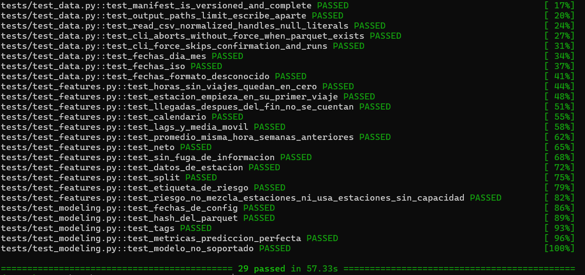
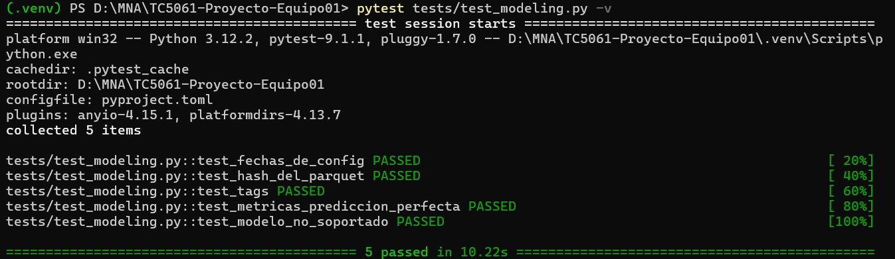
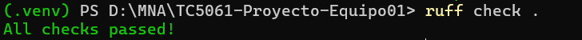
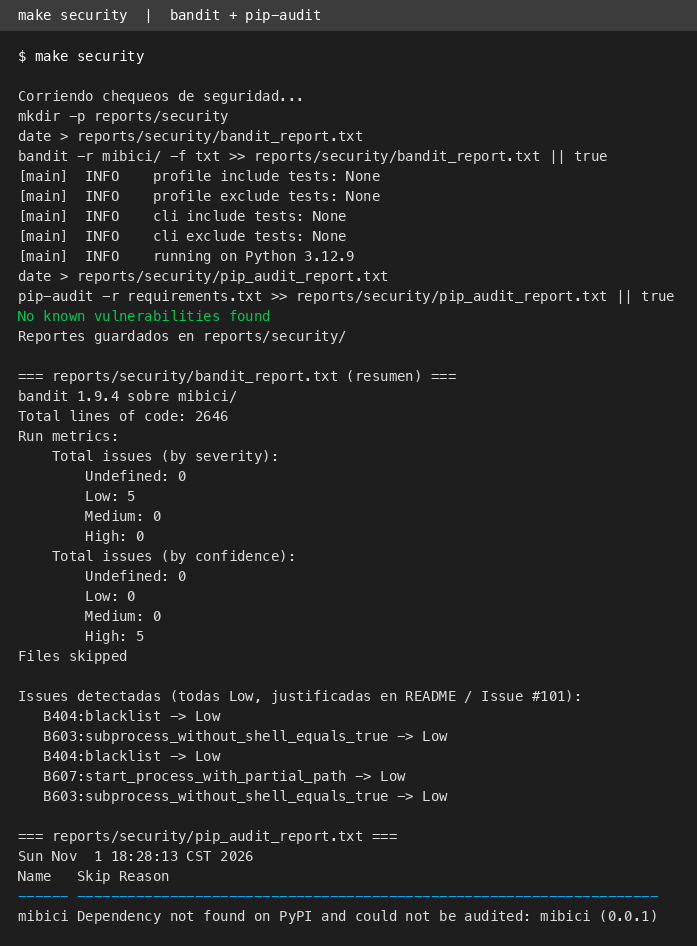

# TC5061 Proyecto MiBici Equipo 01

<a target="_blank" href="https://cookiecutter-data-science.drivendata.org/">
    
</a>

Regresión, clasificación y clustering sobre los viajes del sistema de bicicleta pública de Guadalajara (MiBici), con ingesta reproducible, partición temporal sin fuga y experimentos registrados en MLflow.

## Preguntas de investigación

|    | Pregunta | Tarea | Responsable |
|----|----------|-------|-------------|
| P1 | ¿Cuántos viajes se iniciarán en una estación en un periodo futuro? | Regresión | [@laloz60](https://github.com/laloz60) |
| P2 | ¿Una estación estará en riesgo de quedarse sin bicis/anclajes en un periodo futuro? | Clasificación | [@GemmaMartinez](https://github.com/GemmaMartinez) + [@smuciton](https://github.com/smuciton) |
| P3 | ¿Qué grupos de estaciones comparten patrones de uso y dónde se ubican? | Clustering | [@JesusTafolla](https://github.com/JesusTafolla) |

> **Reparto de P2:** es la tarea más pesada (diseño del proxy de riesgo + baseline de clasificación + evidencia MLflow), así que se divide en dos: **@smuciton** diseña y justifica el proxy de riesgo (#6) y **@GemmaMartinez** implementa el baseline de clasificación con su run en MLflow (#7).

## Datos

- **Fuente:** [datos abiertos de MiBici](https://mibici.net/es/datos-abiertos) — CSVs mensuales de viajes + nomenclatura de estaciones.
- **Cobertura:** 2023-05 a 2026-09 (**41 meses**, corte postpandemia decidido por el equipo: fin de la emergencia sanitaria COVID-19, mayo 2023) → **15,376,127 viajes** y **484 estaciones**.
- **Lo que se versiona en Git:** solo `data/manifest.json` (hash SHA-256 de cada CSV, del Parquet unificado y de la nomenclatura). Los CSVs (~1.2 GB) y el Parquet (321 MB) **no se suben al repositorio**; se regeneran con la ingesta y el manifiesto garantiza que sean idénticos.
- **Partición temporal sin fuga** (definida en `mibici/config.py`, nunca se mezclan meses futuros con el entrenamiento):

| Split  | Rango |
|--------|-------|
| train  | 2023-05 .. 2024-12 |
| val    | 2025-01 .. 2025-06 |
| test   | 2025-07 .. 2026-09 |

## Requisitos

- Python 3.12
- ~2 GB de espacio libre (CSVs + Parquet)
- [uv](https://docs.astral.sh/uv/getting-started/installation/): `mlflow run` lo usa para crear el entorno del `python_env.yaml` (Python 3.12.9 con versiones fijadas). Sin uv, MLflow necesita pyenv y falla con `'None' install 3.12.9`.
- **Windows:** activar el *Modo de programador* (Configuración → Actualización y seguridad → Para programadores). `mlflow run` crea symlinks al instalar dependencias; sin ese permiso falla con `WinError 1314`.

## Instalación

```bash
git clone https://github.com/laloz60/TC5061-Proyecto-Equipo01.git
cd TC5061-Proyecto-Equipo01
python3.12 -m venv .venv         # PowerShell: python -m venv .venv
source .venv/bin/activate        # Windows: .venv\Scripts\activate
pip install -r requirements.txt  # instala también el paquete mibici (-e .)
```

## Descarga de datos

**Clon limpio (desde cero):** solo hace falta este comando. Descarga los 41 CSVs mensuales y la nomenclatura de estaciones (~1.2 GB) y los unifica en un Parquet:

```bash
python -m mibici.dataset
```

> Si vas a reproducir la entrega con `mlflow run` (ver [Reproducir con `mlflow run`](#reproducir-con-mlflow-run)), el entry point `ingest` ya ejecuta este mismo paso; no hace falta correrlo aparte.

**Opcionales** (no se necesitan en un clon limpio):

| Comando | Cuándo usarlo |
|---------|---------------|
| `python -m mibici.dataset --skip-download` | Ya tienes los CSVs en `data/raw/csv/` y solo quieres volver a unificarlos (p. ej. después de un cambio en la normalización). Falla si falta algún CSV. |
| `python -m mibici.dataset --force` | El Parquet unificado ya existe y quieres regenerarlo sin que se detenga a preguntar `¿Continuar?`. Los CSVs que ya están descargados se reutilizan. |
| `python -m mibici.dataset --limit 2` | Prueba rápida con solo 2 meses, para revisar que la ingesta funciona sin descargar todo. Escribe sus salidas aparte y no toca el Parquet ni el manifiesto completos. |

Salidas:

```
data/raw/mibici_viajes_2023_05_a_2026_09.parquet   # Parquet unificado (no versionado)
data/raw/nomenclatura_estaciones.parquet           # 484 estaciones: capacidad, lat/lon
data/manifest.json                                 # versionado: totales + SHA-256
```

Con `--limit` los archivos de prueba salen en `data/raw/mibici_viajes_limit.parquet` y `data/manifest_limit.json`: no se versionan y no reemplazan a los de arriba, así que el manifiesto completo solo lo escribe la ingesta completa.

Verificación de que tus datos son idénticos a los del equipo:

```bash
pytest            # pruebas de ingesta, manifiesto y features
```

Si `pytest` falla con `assert 15376153 == 15376127` en `test_unified_parquet_exists_and_is_non_empty`, no es un error del código: MiBici actualizó el CSV de 2023-05 después de que se generó el manifiesto versionado, así que tu descarga ya no coincide con él. Para validar tu entorno con los datos que descargaste:

```bash
python -m mibici.dataset --skip-download --force   # regenera el manifiesto local con tus datos (~1.5 min, sin volver a descargar)
pytest                                             # ahora deben pasar las 67 pruebas
git restore data/manifest.json                     # no commitees el manifiesto regenerado
```

En ese caso `pytest` confirma que la ingesta es consistente (Parquet, manifiesto y hashes cuadran) y que features y modelos funcionan, pero ya no que tus datos sean idénticos a los del equipo.

## Features (P1 y P2)

```bash
python -m mibici.features
```

Genera `data/processed/features_estacion_hora.parquet` con una fila por estación y hora: salidas, llegadas, variables de calendario, lags, promedios y capacidad de la estación. Los lags y promedios solo usan horas anteriores.

## P2 (Clasificación)

Para ejecutar el entrenamiento de los modelos de clasificación y registrar los experimentos y artefactos en MLflow, utiliza los siguientes comandos:

```bash
python -m mibici.modeling.train p2 --model-name dummy
python -m mibici.modeling.train p2 --model-name logreg
```
Esta etapa evalúa y predice si una estación se encuentra en riesgo de desabastecimiento de bicicletas. Mediante 2 modelos, depende de cual seleccionemos.
1. **Modelo Baseline (`dummy`):** Clasificador por defecto que establece el rendimiento mínimo de referencia utilizando clases mayoritarias.
2. **Modelo Candidato (`logreg`):** Modelo basado en Regresión Logística, diseñado para capturar relaciones lineales.

## Experimentos (MLflow)

### Servidor de tracking

El Model Registry necesita un almacenamiento respaldado por base de datos, así que el tracking se levanta con un servidor local sobre SQLite:

```bash
mlflow server --backend-store-uri sqlite:///mlflow.db --port 5000
# UI en http://127.0.0.1:5000
```

En otra terminal (o antes de lanzar cualquier corrida), apunta la variable de entorno al servidor para que todos los runs se registren ahí:

```bash
export MLFLOW_TRACKING_URI="http://127.0.0.1:5000"      # bash / macOS / Linux / Git Bash
```
```powershell
$env:MLFLOW_TRACKING_URI = "http://127.0.0.1:5000"     # PowerShell
```
En CMD, sin espacios ni comillas (CMD guarda en la variable todo lo que va después del `=`, incluido un espacio al final):

```cmd
set MLFLOW_TRACKING_URI=http://127.0.0.1:5000
echo [%MLFLOW_TRACKING_URI%]
```

El `echo` debe mostrar `[http://127.0.0.1:5000]`, con el `]` pegado al `5000`. Si aparece `[http://127.0.0.1:5000 ]`, la variable quedó con un espacio y `mlflow run` falla con `Invalid url: http://127.0.0.1:5000 /api/...`: vuelve a escribir el `set`.

La variable solo vive en la terminal donde se definió: los `mlflow run` deben lanzarse desde esa misma terminal. Puedes persistirla en `.env` (no se versiona) para no repetirla en cada sesión. Todas las corridas de esta entrega se lanzan con `mlflow run`, no desde un notebook.

> `mlflow.db` y `mlruns/` **no se versionan** (están en `.gitignore`, junto con `mlartifacts/`, los datos MiBici y los modelos serializados). En un clon nuevo el tracking arranca vacío, así que los runs se regeneran con los comandos de esta sección (las capturas de evidencia están en `reports/figures/mlflow_evidencia/`).

### Reproducir con `mlflow run`

Con el servidor arriba y `MLFLOW_TRACKING_URI` definida, desde la raíz del repo y en este orden. `--experiment-name` va siempre, para que los runs no caigan en `Default`; `--env-manager uv` crea el entorno aislado del `python_env.yaml` (la primera vez tarda ~1 min, después se reutiliza).

```bash
# 1. Datos y features
mlflow run . --experiment-name mibici-equipo01 --env-manager uv -e ingest              # macOS / Linux
mlflow run . --experiment-name mibici-equipo01 --env-manager uv -e ingest -P limit=0   # Windows
mlflow run . --experiment-name mibici-equipo01 --env-manager uv -e features

# 2. Baselines
mlflow run . --experiment-name mibici-equipo01 --env-manager uv -e train -P question=p1 -P model=regla
mlflow run . --experiment-name mibici-equipo01 --env-manager uv -e train -P question=p2 -P model=dummy
mlflow run . --experiment-name mibici-equipo01 --env-manager uv -e train -P question=p3 -P model=random

# 3. Modelo elegido de cada pregunta
mlflow run . --experiment-name mibici-equipo01 --env-manager uv -e train -P question=p1 -P model=rf -P n_estimators=300
mlflow run . --experiment-name mibici-equipo01 --env-manager uv -e train -P question=p2 -P model=logreg
mlflow run . --experiment-name mibici-equipo01 --env-manager uv -e train -P question=p3 -P model=k-means++ -P n_init=10

# 4. Model Registry
mlflow run . --experiment-name mibici-equipo01 --env-manager uv -e register
```

Valores de `model` por pregunta (vacío = baseline): p1 `regla` | `ridge` | `rf` · p2 `dummy` | `logreg` · p3 `random` | `k-means++`. Los parámetros completos de cada entry point están en el `MLproject`; los defaults (rutas, fechas, semilla) viven en `mibici/config.py`.

Notas:

- **`-P limit=0` en la ingesta (solo Windows)** significa "sin límite". En Windows, el default vacío llega como `""` y la ingesta falla con `Invalid value for '--limit'`; en macOS/Linux no hace falta.
- **Re-ejecutar la ingesta** cuando el Parquet ya existe: agrega `-P force=true`, o se detiene a preguntar `¿Continuar?`. Para no volver a descargar los CSV: `-P skip_download=true`.
- **`features` es obligatorio** antes de entrenar P1 y P2. Sus runs (y los de `ingest`) no registran métricas ni parámetros: solo dejan trazabilidad de commit y entry point.
- **Tiempos de referencia** (Windows, conexión doméstica): ingesta completa ~7.5 min (descarga ~6 min), features ~1 min, P2 `logreg` ~4.5 min, P3 <1 min.
- **Datos de la fuente:** MiBici puede actualizar CSV ya publicados. Al 22 oct 2026, el de 2023-05 trae 26 viajes más que el registrado en `data/manifest.json` (15,376,153 vs 15,376,127 en total), así que una descarga nueva produce otros hashes y `pytest` marca esa diferencia (ver [Descarga de datos](#descarga-de-datos) para validar con tus datos). El manifiesto versionado es la referencia del equipo: **no lo commitees al re-ejecutar la ingesta** (`git restore data/manifest.json`).

La salida completa de estos comandos en un clon limpio (comando, respuesta del log y resultado de cada paso) está en [`reports/validacion_clon_limpio_issue62.md`](reports/validacion_clon_limpio_issue62.md).

La comparación de baseline contra candidato de cada pregunta está en [`reports/baseline_vs_candidato.md`](reports/baseline_vs_candidato.md).

### Model Registry

`mlflow run . -e register` (`mibici/modeling/register.py`) registra el mejor run de cada pregunta según su métrica de **validación** (la selección no mira test; esa ventana queda solo para el reporte final):

| Pregunta | Modelo registrado | Métrica de selección |
|---|---|---|
| P1 | `mibici-equipo01-p1-demanda` | `val_mae` (menor es mejor) |
| P2 | `mibici-equipo01-p2-riesgo` | `val_roc_auc` (mayor es mejor) |
| P3 | `mibici-equipo01-p3-grupos` | `val_silhouette_score` (mayor es mejor) |

- Busca primero entre las corridas con tag `stage_of_work=candidate`; si ninguna tiene modelo logueado, usa todas las corridas de la pregunta.
- Cada versión lleva en su descripción el linaje: run de origen, commit y hashes del manifiesto y del Parquet.
- No registra dos veces el mismo run: re-ejecutarlo es seguro.
- **Ciclo de vida:** la versión en producción se marca con el alias `@champion` y se carga por nombre:

  ```python
  import mlflow
  modelo = mlflow.pyfunc.load_model("models:/mibici-equipo01-p2-riesgo@champion")
  ```

### Ejecución directa (sin MLflow Project)

Útil para desarrollo. Para reproducir la entrega usa los comandos `mlflow run` de arriba. Las búsquedas con nested runs de P1 y P3 hoy solo se lanzan así: `python -m mibici.modeling.train p1-search` y `python -m mibici.modeling.train p3-search`.

- Experimento: `mibici-equipo01`
- Convención de runs: nombre `P1-baseline`, `P2-baseline-logreg`, `P3-kmeans`; tags `equipo=01`, `pregunta=P1|P2|P3`, `commit=<sha>`; params incluyen rango de fechas y hash del manifiesto; al menos 1 artefacto por run.
- Entrenamiento: `python -m mibici.modeling.train`. Antes de P1 y P2 correr `python -m mibici.features` para generar las features.
- **P1 (Regresión)** — baseline `regla` (no entrena) y candidatos `ridge` y `rf`:
  ```bash
  python -m mibici.modeling.train p1 --model regla
  python -m mibici.modeling.train p1 --model ridge
  python -m mibici.modeling.train p1 --model rf
  ```
- **P2 (Clasificación)** — baseline `dummy` y candidato `logreg`:
  ```bash
  python -m mibici.modeling.train p2 --model-name dummy
  python -m mibici.modeling.train p2 --model-name logreg
  ```
- **P3 (Clustering)** — baseline (K-Means con inicialización aleatoria). El pipeline completo es de tres pasos:
  ```bash
  python -m mibici.modeling.train p3    # entrena K-Means (k=5) y lo serializa en models/kmeans_p3.pkl
  python -m mibici.modeling.predict p3  # asigna clústeres y escribe reports/p3_evaluation_summary.txt
  python -m mibici.reportes_p3          # regenera el summary y las figuras de P3 desde los datos
  ```
  El tercer comando (`mibici/reportes_p3`) reconstruye `reports/p3_evaluation_summary.txt`,
  `reports/figures/p3_distribucion_clusters.png` y `reports/figures/p3_mapa_geografico.png`
  sin depender de binarios versionados, así el reporte es reproducible en un clon limpio.

Las capturas de pantalla de los *runs*, artefactos y comparación de modelos se encuentran en:
```text
reports/figures/mlflow_evidencia/
```

## Pruebas de calidad y seguridad
El proyecto incluye pruebas con `pytest`, validación de datos con `DeepChecks` y chequeos de seguridad (`bandit` + `pip-audit`).

**Estructura de `tests/`** (7 archivos, 67 pruebas)
- `tests/test_data.py` (12): datos de MiBici, validación de SHA-256 e integridad del parquet unificado, comportamiento del CLI y parsing de fechas. Incluye casos límite: header malformado de 2023-04, literales nulos y formato de fecha desconocido.
- `tests/test_features.py` (13): cálculo de features por estación y hora, lags, media móvil, calendario, split temporal y etiqueta de riesgo de P2. Cubre casos límite como horas sin viajes, estación que empieza en su primer viaje y llegadas fuera de la ventana. Incluye `test_sin_fuga_de_informacion`.
- `tests/test_modeling.py` (14): fechas de `config`, hash del parquet, tags de MLflow, métricas de regresión, selección por validación, silhouette de P3 y perfil de ventana. Casos límite: silhouette con una sola fila (`NaN`) y ventana de perfil vacía.
- `tests/test_reproducibilidad.py` (3): dos entrenamientos con la misma semilla dan las mismas predicciones y métricas; con semilla distinta cambian (control negativo); Ridge es estable entre corridas.
- `tests/test_register.py` (13): detección de modelo logueado, selección del mejor run por métrica de validación, fallback a corridas previas e idempotencia del registro con alias `@champion`.
- `tests/test_proxy_riesgo.py` (11): construcción de la tabla de riesgo de P2, sensibilidad al umbral, top de estaciones y plots. Casos límite: estación sin desbalance, estación inexistente en nomenclatura y corte `n` exacto.
- `tests/test_data_validation.py` (2): validación del esquema y de la corrida completa de DeepChecks (esta última corre solo con el entorno de validación creado).

**Comandos para ejecutar**
Ya estando en el entorno virtual, es necesario ejecutar

1. Pruebas unitarias `pytest`
  ```bash
pytest -v
  ```

Salida ejemplo
  ```bash
platform darwin -- Python 3.12.9, pytest-9.1.1, pluggy-1.7.0 -- .venv/bin/python
cachedir: .pytest_cache
rootdir: /Users/gerardocarreno/Documents/MaestriaTecMonterrey/CuartoTrimestre/MLOps/Semana_5/TC5061-Proyecto-Equipo01
configfile: pyproject.toml
plugins: platformdirs-4.13.3, anyio-4.15.1
collecting ... collected 67 items

tests/test_data.py::test_catalog_cover_post_pandemic_history PASSED      [  1%]
tests/test_data.py::test_normalize_columns_canonical_schema PASSED       [  2%]
tests/test_data.py::test_normalize_columns_mangled_header_2023_04 PASSED [  4%]
tests/test_data.py::test_unified_parquet_exists_and_is_non_empty PASSED  [  5%]
tests/test_data.py::test_manifest_is_versioned_and_complete PASSED       [  7%]
tests/test_data.py::test_output_paths_limit_escribe_aparte PASSED        [  8%]
...
tests/test_reproducibilidad.py::test_misma_semilla_repite_predicciones_y_metricas PASSED [ 97%]
tests/test_reproducibilidad.py::test_semilla_distinta_cambia_el_entrenamiento PASSED [ 98%]
tests/test_reproducibilidad.py::test_ridge_tambien_es_reproducible PASSED [100%]

================== 67 passed, 1 warning in 20.54s ===================
  ```

> Para que las 67 corran hace falta el entorno de validación del punto 3 (`make validation_env`): sin él, `test_validacion_completa_con_deepchecks` se salta y el total queda en 66.

Captura de pantalla para verificar que se ejecute correctamente `reports\figures\evidencia_pruebas_calidad_seguridad\pytest`


2. Pruebas de reproducibilidad del entrenamiento
  ```bash
pytest tests/test_reproducibilidad.py -v
  ```

Verifica que dos entrenamientos con la misma semilla producen las mismas predicciones y métricas, que cambiar la semilla sí altera el resultado (control negativo) y que Ridge es estable entre corridas.

3. Validación de datos con `DeepChecks`

Revisa tipos, valores faltantes, duplicados y drift entre train y test. Corre en un entorno aparte porque DeepChecks 0.19.1 no funciona con las versiones de scikit-learn y NumPy del proyecto.

  ```bash
make validation_env   # solo la primera vez
make validate
  ```

Sin `make`, en Windows:

  ```bash
uv venv --python 3.12 .venv-validacion
uv pip install --python .venv-validacion\Scripts\python.exe -r requirements-validation.txt
.venv-validacion\Scripts\python.exe -W ignore -m mibici.data_validation
  ```

La salida queda en `reports/data_validation/resumen.json`. Los hallazgos y las acciones tomadas están en [`reports/validacion_datos.md`](reports/validacion_datos.md).

**Resumen del último chequeo** (15,376,127 viajes, semilla 42, muestras de 200,000 filas):

| Chequeo | Resultado |
|---|---|
| Tipos de datos | `ok = True`, sin diferencias contra el esquema esperado |
| Valores faltantes | `genero` 104,981 (0.68%) · `anio_nacimiento` 7,773 (0.05%) · resto 0 |
| Duplicados | 758 filas exactas · 1,065 mismos viajes con otro `viaje_id` |
| DeepChecks (muestra) | sin tipos mezclados · 0.0% de filas duplicadas |
| Drift viajes (train vs test) | ninguna columna marcada · máx. `anio_nacimiento` 0.0788 (K-S) |
| Drift features (train vs test) | ninguna columna marcada · máx. `mes` 0.1832 (Cramer's V) |

El umbral de drift es 0.2 y ninguna columna lo alcanza. Las 758 filas duplicadas exactas ya se eliminan al generar las features.

Captura de la ejecución de `make validate` con DeepChecks, `reports\figures\evidencia_pruebas_calidad_seguridad\DeepChecks.png`


4. Análisis de calidad
  ```bash
ruff check .
  ```

Salida ejemplo
  ```bash
All checks passed!
  ```

Captura de pantalla para verificar que se ejecute correctamente `reports\figures\evidencia_pruebas_calidad_seguridad\ruff.png`


5. Chequeos de seguridad (`bandit` + `pip-audit`)
  ```bash
make security
  ```

Los reportes quedan en `reports/security/bandit_report.txt` y `reports/security/pip_audit_report.txt`.

Captura de la ejecución de `make security`, `reports\figures\evidencia_pruebas_calidad_seguridad\security.png`


### Comparación de Familias de Modelos

Explorarando múltiples algoritmos, el pipeline de entrenamiento ahora compara distintas familias de modelos utilizando *nested runs* en MLflow para cada pregunta de investigación:

- **P1 (Regresión):** Se compara el baseline (regla del promedio de la misma hora en las 4 semanas previas) contra `Ridge`, `RandomForestRegressor` y la nueva familia `GradientBoostingRegressor`.
- **P2 (Clasificación):** Se compara el baseline (`Dummy`) contra `LogisticRegression` y la nueva familia `RandomForestClassifier`.
- **P3 (Clustering):** Se compara el baseline (`KMeans` con inicialización aleatoria) contra `KMeans++` y la nueva familia `GaussianMixture`.

Para ejecutar las búsquedas de hiperparámetros y registrar los candidatos de estas nuevas familias en tu servidor local de MLflow, ejecuta:
```bash
python -m mibici.modeling.train p1-search
python -m mibici.modeling.train p2 --model-name rf
python -m mibici.modeling.train p3-search
```

## Buenas prácticas

- **Métricas**: se nombran con el conjunto donde se calculan, `<split>_<métrica>` — `test_rmse`, `test_roc_auc`, `test_silhouette_score` (ver `mibici/modeling/train.py`).
- **Notebooks**: convención CCDS `notebooks/<número>-<descripción>.ipynb` (p. ej. `1.0-iniciales-descripcion.ipynb`). Solo exploración: lo que se reutiliza baja a los módulos (`mibici/features.py`, `mibici/modeling/`). Sin datos personales de usuarios en las gráficas exportadas.
- **Credenciales y datos personales**: nunca se suben a MLflow ni al repo. Viven en `.env`, que está en `.gitignore`; los runs solo registran params y tags públicos.
- **Config centralizada**: rutas, cortes de fechas y `SEED` se leen de `mibici/config.py`, sin duplicarlos en `mibici/dataset.py` ni en `mibici/modeling/`.
- **`.gitignore`**: excluye los datos MiBici (`/data/*`, salvo `data/manifest.json`), `mlruns/`, `mlartifacts/`, `.env` y los modelos serializados (`models/*.pkl`, `models/*.joblib`, `models/*.onnx`, `models/*.bin`).
- **Versionado de datos**: `data/manifest.json` guarda el SHA-256 del parquet unificado y de la nomenclatura, con el total de viajes y estaciones. Es lo único de `data/` que entra al repo.

## Seguridad y Calidad del Código

Para garantizar que el repositorio no exponga credenciales ni dependencias vulnerables, integramos herramientas de análisis estático y auditoría de seguridad:

- **Chequeo de credenciales (Issue #102):** El archivo `.gitignore` excluye explícitamente `.env`, bases de datos locales (`mlflow.db`) y datos crudos (`data/raw/`). Se verificó en el historial mediante `git ls-files` que no existen secretos expuestos. Asimismo, una búsqueda con `git grep` descartó credenciales hardcodeadas. La plantilla versionada es [`.env.example`](.env.example): se copia a `.env` (no versionado) y se edita.
- **Análisis estático (Bandit v1.9.4):** Se ejecuta sobre el directorio `mibici/`. Se detectaron 5 alertas de severidad baja (Low) asociadas al uso de `subprocess` en `tracking.py` y `mlflow_entry.py`. **Justificación (Issue #101):** Estas alertas se asumen como seguras ya que los subprocesos solo ejecutan comandos internos de infraestructura (`git rev-parse HEAD` y llamadas nativas a Python), sin procesar *input* externo no confiable. El reporte completo está en `reports/security/bandit_report.txt`.
- **Auditoría de dependencias (pip-audit v2.10.1):** El escaneo inicial detectó la vulnerabilidad *CVE-2026-53995* en la librería `mlflow` (v3.17.0). **Resolución:** Se mitigó el riesgo actualizando la dependencia a `mlflow==3.17.2` en el archivo `requirements.txt`, resultando en una auditoría limpia. El reporte está en `reports/security/pip_audit_report.txt`.

Para ejecutar automatizadamente los chequeos de seguridad (Issue #101), utiliza el siguiente comando de `make`:
```bash
make security
```

## Ejecución de Pruebas y Chequeos de Seguridad

Para garantizar la calidad y seguridad del código, este repositorio integra pruebas unitarias, validación de datos y análisis estático. Todo el flujo está orquestado mediante `Make`.

### Instrucciones de ejecución
Desde la raíz del repositorio, crea una vez el entorno de validación con `make validation_env` y ejecuta el siguiente comando unificado:
```bash
make check-all
```

- **Limpieza y privacidad:** consulta la [preparación y protección de datos](docs/clean_doc).


## Estructura del proyecto

```
├── LICENSE            <- Licencia open-source (MIT)
├── Makefile           <- Comandos de conveniencia (make data, make test, ...)
├── README.md          <- Este archivo
├── data
│   ├── external       <- Datos de terceros
│   ├── interim        <- Datos intermedios transformados
│   ├── processed      <- datasets finales para modelado
│   ├── raw            <- Parquet unificado + CSVs descargados (NO versionados)
│   └── manifest.json  <- Versionado: totales + SHA-256 de cada archivo de datos
│
├── docs               <- Proyecto mkdocs
│   └── clean_doc.md   <- Documentación limpieza de datos
├── models             <- Modelos entrenados y serializados
├── notebooks          <- Notebooks Jupyter (iniciales: <iniciales>-<descripción>)
├── pyproject.toml     <- Metadatos del paquete mibici + config de ruff
├── references         <- Diccionarios de datos, ML Canvas, documentos de diseño
├── reports
│   └── figures        <- Gráficas para el reporte (evidencia MLflow, etc.)
├── reports
│   └── evidencia_pruebas_calidad_seguridad  <- Capturas de pytest, deepchecks y seguridad
│
├── requirements.txt   <- Dependencias fijadas (reproducibilidad)
│
├── mibici             <- Código fuente
│   ├── config.py          <- Rutas, semilla, corte de datos y partición temporal
│   ├── dataset.py         <- Ingesta: descarga → normalización → Parquet + manifiesto
│   ├── features.py        <- Feature engineering sin fuga temporal
│   ├── modeling
│   │   ├── train.py       <- Entrenamiento P1/P2/P3
│   │   └── predict.py     <- Inferencia
│   ├── reportes_p3.py     <- Regenera summary y figuras de P3 sin binarios
│   └── plots.py           <- Visualizaciones
│
└── tests              <- Pruebas (pytest)
```

## Flujo de trabajo Git

- **Todo cambio entra por PR**: `main` es una rama protegida (`Require pull request before merging`); ningún cambio se fusiona directamente, ni aunque sea un archivo completamente nuevo.
- **VoBo obligatorio**: todo Pull Request necesita la aprobación de **al menos un compañero** antes de mergeearse.
- **Ramas:** `feature/<nombre-corto>` o `fix/<issue>`.
- **Commits:** [Conventional Commits](https://www.conventionalcommits.org/) — `feat:`, `docs:`, `test:`, `chore:`, `fix:`.
- **Requisito de rúbrica:** cada integrante abre **al menos 1 PR** y reviewa **al menos 1 PR** de otro integrante.
- Ciclo de reviews: Gerardo → Gemma → Jesús → smuciton → Gerardo.

## Integrantes y responsabilidades

| Integrante | GitHub | Responsabilidades |
|------------|--------|-------------------|
| Gerardo Lozano | [@laloz60](https://github.com/laloz60) | Infra e ingesta de datos, `features.py`, P1 baseline de regresión, README |
| Gemma Martínez | [@GemmaMartinez](https://github.com/GemmaMartinez) | P2 — baseline de clasificación (#7), evidencia MLflow (#11) |
| Jesús Tafolla | [@JesusTafolla](https://github.com/JesusTafolla) | Clustering P3 (#8), propuesta de modelos y métricas (#9) |
| smuciton | [@smuciton](https://github.com/smuciton) | Definición de datos y condiciones de uso (#2), diagrama de arquitectura (#3), P2 — proxy de riesgo (#6) |
