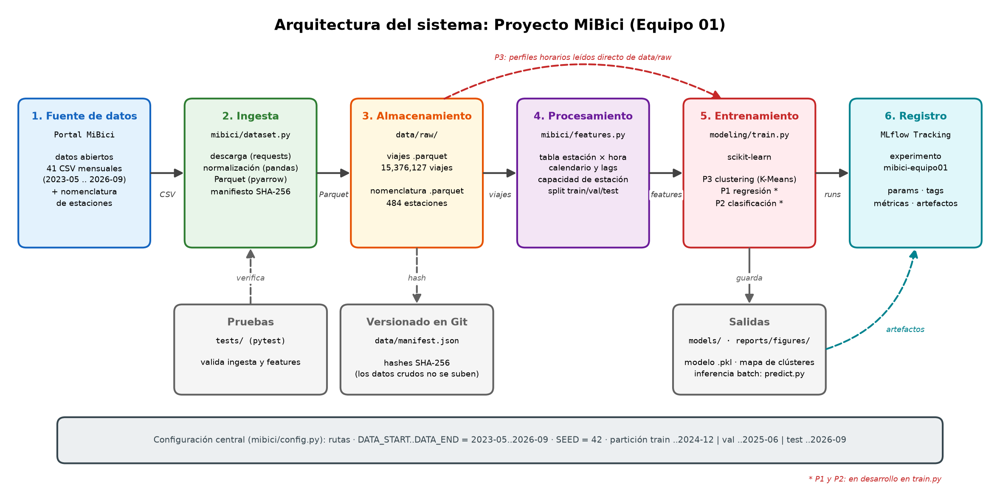

# Arquitectura del sistema: Proyecto MiBici

## 1. Componentes

| # | Capa | Implementación | Entrada → Salida |
|---|---|---|---|
| 1 | Fuente de datos | Portal de datos abiertos de MiBici | 41 CSV mensuales de viajes (2023-05 .. 2026-09) + `nomenclatura_2026_09.csv` |
| 2 | Ingesta | `mibici/dataset.py` | CSV → descarga, normalización de columnas, encoding y fechas → Parquet unificado + `data/manifest.json` |
| 3 | Almacenamiento | `data/raw/` | `mibici_viajes_2023_05_a_2026_09.parquet` (15,376,127 viajes) y `nomenclatura_estaciones.parquet` (484 estaciones) |
| 4 | Procesamiento | `mibici/features.py` | Viajes → tabla estación × hora con calendario, lags, medias, capacidad y split → `data/processed/features_estacion_hora.parquet` |
| 5 | Entrenamiento | `mibici/modeling/train.py` | Features / perfiles horarios → modelos P1 (regresión), P2 (clasificación) y P3 (clustering) |
| 6 | Registro | MLflow Tracking, experimento `mibici-equipo01` | Runs con params, tags, métricas y artefactos |

Componentes de soporte:

- **Configuración central** (`mibici/config.py`): rutas, periodo de datos, `SEED = 42` y fechas de corte de la partición temporal. Ningún otro módulo define estos valores.
- **Versionado** (Git / GitHub): código y `data/manifest.json`. Los CSV (~1.2 GB) y el Parquet no se suben; se regeneran con `python -m mibici.dataset` y se verifican contra los hashes del manifiesto.
- **Pruebas** (`tests/`, pytest): validan la ingesta, el manifiesto y que las features no usen información futura.
- **Salidas** (`models/`, `reports/figures/`): modelos serializados con joblib e inferencia batch con `mibici/modeling/predict.py`.

Estado actual: en `train.py` está implementado P3 (K-Means); P1 y P2 están en desarrollo. P3 calcula sus perfiles horarios directamente desde el Parquet de `data/raw/`, sin pasar por `features.py`.

## 2. Flujo

1. `python -m mibici.dataset` descarga los CSV, los normaliza, escribe el Parquet unificado y el manifiesto.
2. `python -m mibici.features` construye la tabla estación × hora y asigna train / val / test por fecha.
3. `python -m mibici.modeling.train p3` (y `p1`, `p2` cuando estén listos) entrena, evalúa y registra cada run en MLflow.
4. `mlflow ui` permite comparar los runs del experimento `mibici-equipo01`.

## 3. Justificación de herramientas

### 3.1 pandas: limpieza y transformación

- Los CSV de MiBici cambian entre meses: encoding UTF-8 o latin-1, encabezados dañados, literales `NULL` y fechas en dos formatos. `pandas.read_csv` con respaldo de encoding, `to_numeric(errors="coerce")` y `to_datetime` con formato explícito resuelven estos casos en pocas líneas.
- Los tipos *nullable* (`Int64`, `Int32`, `string`) conservan los nulos sin convertir enteros a flotantes, así el esquema queda estable entre meses.
- `groupby` + `shift` + `rolling` por estación permiten construir lags y medias móviles que solo miran horas anteriores, que es la regla para evitar fuga de información en P1 y P2.
- Con 15.4 millones de viajes el volumen cabe en una sola máquina; no se justifica un motor distribuido como Spark.

### 3.2 pyarrow / Parquet: almacenamiento

- **Columnar:** cada etapa lee solo las columnas que necesita (`features.py` lee 4 de 8; P3 lee 2), lo que reduce memoria y tiempo.
- **Compresión:** los CSV ocupan ~1.2 GB y el Parquet unificado ~339 MB (compresión snappy).
- **Esquema tipado:** el Parquet guarda los tipos; quien lo lee recibe fechas como `datetime` y IDs como enteros sin volver a parsear.
- **Escritura en streaming:** `pyarrow.parquet.ParquetWriter` escribe un mes a la vez, así la ingesta no necesita cargar todo el histórico en RAM.

### 3.3 Manifiesto SHA-256: versionado de datos

- `data/manifest.json` guarda URL, tamaño y hash SHA-256 de cada CSV, del Parquet y de la nomenclatura, más el total de viajes y estaciones.
- Es un archivo pequeño que sí entra a Git: cualquier integrante puede regenerar los datos y comprobar que son idénticos a los del equipo.
- El hash del manifiesto puede registrarse en MLflow como `data_version`, lo que liga cada run con la versión exacta de los datos.
- Es una alternativa más ligera que una herramienta dedicada (p. ej. DVC) para un dataset que se reconstruye desde una fuente pública.

### 3.4 scikit-learn: modelado

- Una sola API (`fit`, `predict`, `score`) para regresión, clasificación y clustering; los tres problemas del proyecto se resuelven con la misma librería.
- Incluye los *baselines* propuestos en `references/modelos_y_metricas.md` (`DummyRegressor`, `DummyClassifier`, `KMeans(init="random")`) y los candidatos (`RandomForestRegressor`, `LogisticRegression`, `GradientBoostingClassifier`, K-Means++).
- Trae las métricas elegidas: RMSE, ROC-AUC, F1 macro y `silhouette_score`.
- `random_state=SEED` hace los entrenamientos reproducibles, y los modelos se serializan con joblib.

### 3.5 MLflow Tracking: registro de experimentos

- Cada run guarda **parámetros** (hiperparámetros, `random_state`), **métricas** (`test_rmse`, `test_roc_auc`, `test_silhouette_score`), **tags** (equipo, pregunta, commit) y **artefactos** (modelo `.pkl`, mapa de clústeres).
- Todos los runs viven en un solo experimento (`mibici-equipo01`), así se compara baseline contra candidato en la misma interfaz (`mlflow ui`).
- El tag del commit y el hash de los datos permiten reproducir cualquier resultado: qué código, qué datos y qué parámetros lo generaron.
- `mlruns/` y `mlartifacts/` están en `.gitignore`: los resultados no ensucian el repositorio.

### 3.6 Herramientas de soporte

| Herramienta | Uso | Por qué |
|---|---|---|
| requests | Descarga de CSV | Descarga en streaming y reanudable; permite fijar el `User-Agent` que exige el portal |
| typer | CLI de `dataset`, `features`, `train`, `predict` | Cada etapa se ejecuta con un comando y parámetros documentados |
| loguru | Logs | Mensajes legibles de avance y errores en cada etapa |
| pytest | Pruebas | Verifica ingesta, manifiesto y features antes de entrenar |
| Cookiecutter Data Science | Estructura del repo | Separa datos, código, modelos, reportes y referencias con una convención conocida |
