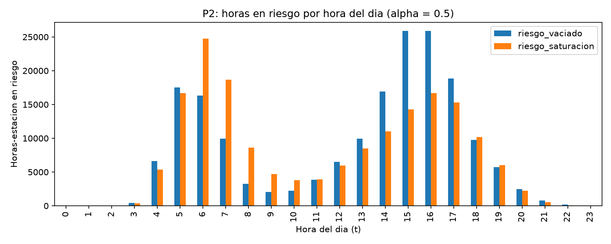

# Proxy de riesgo de estación (P2)

## 1. Problema

MiBici no publica el inventario de bicicletas por estación, así que no se puede
observar directamente si una estación está vacía o llena. P2 necesita una etiqueta
binaria de riesgo, y se aproxima con lo que sí existe: **viajes** (salidas y
llegadas por estación y hora) y **capacidad** de cada estación (`capacidad`,
columna `dpcapacity` de la nomenclatura).

## 2. Definición

Para cada estación *e* y hora *t* (tabla estación × hora de `mibici/features.py`):

**Saldo neto futuro** en las próximas *H* horas:

    neto_fut(e, t) = Σ (salidas(e, t+k) − llegadas(e, t+k)),  k = 1 .. H

- `neto_fut > 0`: salen más bicis de las que llegan → la estación se vacía.
- `neto_fut < 0`: llegan más bicis de las que salen → la estación se llena.

**Etiquetas:**

    riesgo_vaciado    = neto_fut ≥  α · capacidad
    riesgo_saturacion = neto_fut ≤ −α · capacidad
    riesgo            = riesgo_vaciado OR riesgo_saturacion   (variable objetivo de P2)

**Parámetros elegidos:** `H = 3` horas y `α = 0.5`, definidos en `mibici/config.py`
(`RISK_HORIZON_HOURS`, `RISK_ALPHA`). La etiqueta se calcula con
`add_risk_label` en `mibici/features.py`.

## 3. Justificación de los parámetros

- **α = 0.5:** como el inventario inicial es desconocido, se supone que la estación
  está a media capacidad, el punto neutro y el objetivo típico de un rebalanceo.
  Desde ahí, perder la mitad de la capacidad la deja vacía y ganar la mitad la
  llena. El umbral es simétrico y escala con el tamaño de cada estación: 8 bicis
  en una estación de 15 no pesan lo mismo que en una de 39.
- **H = 3 horas:** coincide con el horizonte de 1 a 3 horas del ML Canvas y da
  margen para que el equipo de rebalanceo llegue antes de que ocurra el problema.
- **Sin fuga de información:** la etiqueta usa las horas t+1..t+3; las features
  de `features.py` usan solo horas ≤ t (lags desplazados al menos 1 hora).
  `neto_fut` y las columnas `riesgo*` son el objetivo y nunca se usan como
  variables del modelo.

### Sensibilidad a α (prevalencia de la clase positiva, H = 3)

| α | Vaciado | Saturación | Riesgo total | Train | Val | Test |
|---|---|---|---|---|---|---|
| 0.3 | 5.32 % | 5.17 % | 10.49 % | 11.82 % | 11.29 % | 8.63 % |
| 0.4 | 3.23 % | 3.10 % | 6.33 % | 7.27 % | 6.92 % | 5.01 % |
| **0.5** | **1.70 %** | **1.63 %** | **3.32 %** | **3.88 %** | **3.71 %** | **2.52 %** |
| 0.6 | 1.07 % | 1.03 % | 2.11 % | 2.50 % | 2.36 % | 1.56 % |
| 0.7 | 0.56 % | 0.56 % | 1.12 % | 1.34 % | 1.27 % | 0.81 % |

Con α = 0.5, el riesgo es un evento raro (3.3 % de las horas) pero no tanto que el
modelo se quede sin ejemplos positivos. Esto confirma el desbalance de clases
previsto en `references/modelos_y_metricas.md`, y por eso se evalúa con
`test_roc_auc` y `test_f1_macro` en lugar de *accuracy*.

## 4. Ejemplos reales del dataset

Calculados sobre 2023-05 .. 2026-09 (10.9 M filas estación × hora, 471 estaciones
con viajes y capacidad conocida). La hora indica el momento de la predicción; la
ventana son las 3 horas siguientes.

| Estación | Cap. | Hora (t) | Salidas t+1..t+3 | Llegadas t+1..t+3 | neto_fut | Umbral (0.5·cap) | Etiqueta |
|---|---|---|---|---|---|---|---|
| GDL-132 C. Lope de Vega / Av. La Paz | 15 | 2025-07-01 12:00 | 17 | 10 | +7 | ±7.5 | Sin riesgo |
| GDL-132 C. Lope de Vega / Av. La Paz | 15 | 2025-07-08 14:00 | 28 | 20 | +8 | ±7.5 | **Vaciado** |
| GDL-033 Av. Hidalgo / C. Pedro Loza | 15 | 2025-07-10 16:00 | 62 | 70 | −8 | ±7.5 | **Saturación** |
| GDL-049 Lopez Cotilla / Penitenciaría | 39 | 2025-08-11 06:00 | 142 | 25 | +117 | ±19.5 | **Vaciado** |
| GDL-049 Lopez Cotilla / Penitenciaría | 39 | 2025-07-31 16:00 | 47 | 213 | −166 | ±19.5 | **Saturación** |
| GDL-049 Lopez Cotilla / Penitenciaría | 39 | 2025-07-01 08:00 | 26 | 13 | +13 | ±19.5 | Sin riesgo |

Los dos primeros renglones muestran el límite: con la misma capacidad, un saldo de
+7 no activa la alerta y uno de +8 sí.

### Patrones observados (α = 0.5)

- **Horario:** los positivos se concentran en dos picos. De **5:00 a 7:00** hay
  vaciado y saturación casi en igual medida (salen bicis de zonas residenciales y
  llegan a las de trabajo); a las 6 y 7 domina la saturación. De **14:00 a 17:00**
  domina el **vaciado**, con el regreso desde las zonas de trabajo. Casi no hay
  riesgo de 22:00 a 4:00, consistente con el horario de servicio (no se liberan
  bicis de 1:00 a 4:59).

- **Cobertura:** 375 de 471 estaciones tienen al menos una hora en riesgo.
- **Estaciones con más horas en riesgo:**

| Estación | Cap. | % horas en riesgo | Horas vaciado | Horas saturación |
|---|---|---|---|---|
| GDL-049 Lopez Cotilla / Penitenciaría | 39 | 35.65 % | 4,050 | 6,634 |
| GDL-033 Av. Hidalgo / C. Pedro Loza | 15 | 28.62 % | 794 | 7,781 |
| GDL-093 C. H Colegio Militar / Av. Américas | 15 | 24.66 % | 3,631 | 3,759 |
| GDL-040 C. Morelos / C. Progreso | 19 | 20.85 % | 1,957 | 4,293 |
| GDL-187 Av. 16 de Septiembre / C. Priscilia | 15 | 19.87 % | 284 | 5,669 |

## 5. Uso operativo

El modelo de P2 entrega, cada hora, la probabilidad de riesgo de cada estación
para las próximas 3 horas. El equipo de rebalanceo:

1. **Ordena** las estaciones por probabilidad y despacha primero las de mayor riesgo.
2. **Distingue el tipo de riesgo:** en vaciado lleva bicicletas; en saturación las
   retira para liberar anclajes.
3. **Estima cuántas mover:** aproximadamente `|neto_fut| − 0.5 · capacidad`. Por
   ejemplo, en GDL-132 con neto_fut = +8 y capacidad 15, hay que llevar al menos
   1 bici para no vaciarla.
4. **Planea rutas por franja:** de 5:00 a 7:00 surte las estaciones de origen y
   libera anclajes en las de destino laboral (por ejemplo, GDL-033 y GDL-187, que
   casi siempre se saturan); de 14:00 a 17:00 prioriza surtir las estaciones que
   se vacían con el regreso.

## 6. Limitaciones

- **El inventario inicial es supuesto (50 %)**, no observado. La etiqueta mide la
  *presión* de demanda sobre la estación, no su estado real.
- **El rebalanceo real ya ocurre:** GDL-049 tiene un saldo de +117 bicis en 3 horas
  con solo 39 anclajes, lo que solo es posible si el operador la resurte durante
  la ventana. La etiqueta marca justamente las estaciones que necesitan esa
  intervención.
- **Demanda censurada:** cuando una estación está vacía, los viajes que no se
  pudieron hacer no aparecen en los datos, así que el riesgo real puede estar
  subestimado.
- **Estaciones excluidas:** 4 estaciones de la nomenclatura tienen capacidad 0 y
  2 estaciones con viajes no tienen capacidad válida; se excluyen de P2.
- **Supuesto de llegada:** una llegada se cuenta en la hora en que termina el
  viaje (`fin_viaje`).

## 7. Cómo reproducir

    python -m mibici.proxy_riesgo

- La etiqueta se calcula en `mibici/features.py` (`add_risk_label`).
- `H` y `α` se configuran en `mibici/config.py` (`RISK_HORIZON_HOURS`, `RISK_ALPHA`).
- El comando genera `reports/p2_proxy_sensibilidad.csv`,
  `reports/p2_proxy_top_estaciones.csv` y `reports/figures/p2_riesgo_por_hora.png`.
- Pruebas: `pytest tests/test_features.py`.
