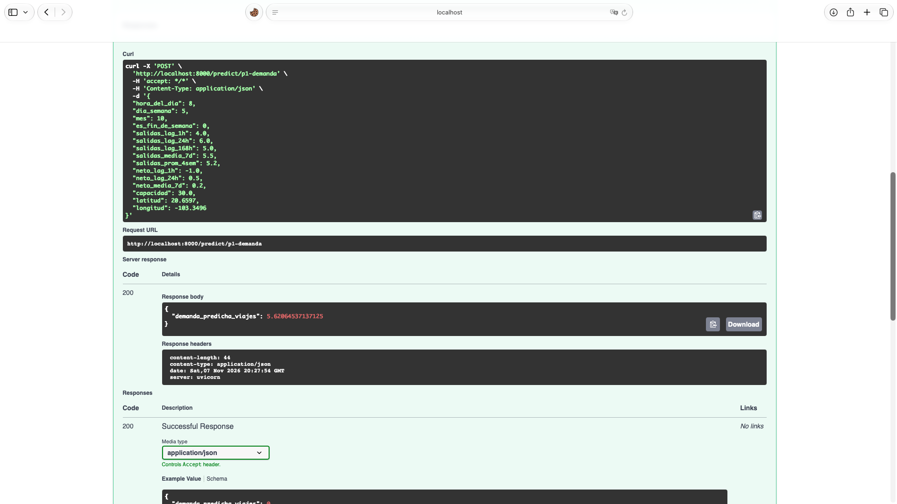

# Evidencia Actividad 8 — API respondiendo desde el contenedor (Issue #125)

**Equipo 01 — TC5061 MLOps**
**Fecha:** 2026-11-03
**Responsables:** laloz60 (Gerardo Carreño) + GemmaMartinez

## Contexto

Se construyó la imagen OCI con el `Dockerfile` de la issue #122 y se ejecutó la API
FastAPI (#127) dentro del contenedor, recuperando los modelos del Model Registry.
El servidor MLflow corrió en el host con `--artifacts-destination`.

```bash
# 1. Servidor MLflow en el host
MLFLOW_SERVER_ALLOWED_HOSTS="localhost:5000,127.0.0.1:5000,host.docker.internal:5000" \
  mlflow server --backend-store-uri sqlite:///mlflow.db --port 5000 \
  --artifacts-destination "$(pwd)/mlruns"

# 2. Build y run del contenedor
make docker-build
make docker-run

# 3. Prueba end-to-end contra el contenedor
make docker-test
```

## Contenedor en marcha

```
$ docker ps --filter name=mibici-api
mibici-api   Up   (healthy)

$ curl http://localhost:8000/health
{"status":"healthy","modelos_cargados":["p1","p2","p3"]}
```

El estado `(healthy)` sale del `HEALTHCHECK` del `Dockerfile`, que consulta
`GET /health` cada 30 s con `--start-period=60s` (tiempo que tarda la descarga
de los 3 modelos `@champion`). Si algún modelo no cargara, `/health` responde
503 y el contenedor pasa a `unhealthy`.

## Logs de arranque (carga de modelos desde el Model Registry)

```
SUCCESS p1: modelo cargado via proxy mlflow-artifacts:/1/models/m-1627f3d59ced4700844564b88998226e/artifacts
SUCCESS p2: modelo cargado via proxy mlflow-artifacts:/1/models/m-64e60b83f5e74fc39d61dbedf9753e55/artifacts
SUCCESS p3: modelo cargado via proxy mlflow-artifacts:/1/models/m-f301c3bd3ab546c098feb182f56bb15b/artifacts
SUCCESS Modelos cargados: ['p1', 'p2', 'p3']
```

## Salida completa de `make docker-test`

```text
bash scripts/test_api.sh

== 1. Health check (GET /health) ==
{"status":"healthy","modelos_cargados":["p1","p2","p3"]}
HTTP status: 200

== 2. Prediccion P1 (POST /predict/p1-demanda) ==
Request:
{
  "hora_del_dia": 8,
  "dia_semana": 5,
  "mes": 10,
  "es_fin_de_semana": 0,
  "salidas_lag_1h": 4.0,
  "salidas_lag_24h": 6.0,
  "salidas_lag_168h": 5.0,
  "salidas_media_7d": 5.5,
  "salidas_prom_4sem": 5.2,
  "neto_lag_1h": -1.0,
  "neto_lag_24h": 0.5,
  "neto_media_7d": 0.2,
  "capacidad": 30.0,
  "latitud": 20.6597,
  "longitud": -103.3496
}
{"demanda_predicha_viajes":5.620645371371248}
HTTP status: 200

== 3. Prediccion P2 (POST /predict/p2-riesgo) ==
{"riesgo_desabasto_o_saturacion":1,"probabilidad_riesgo":0.7448901989148815}
HTTP status: 200

== 4. Prediccion P3 (POST /predict/p3-clustering) ==
{"cluster_asignado":2}
HTTP status: 200

== 5. Entrada invalida (esperado 422 con validacion Pydantic) ==
HTTP status: 422

Prueba terminada.
```

## Resumen de resultados

| # | Prueba | Endpoint | Esperado | Obtenido |
|---|--------|----------|----------|----------|
| 1 | Health check con los 3 modelos | `GET /health` | 200 | ✅ **200** |
| 2 | Predicción P1 (demanda) | `POST /predict/p1-demanda` | 200 + JSON | ✅ **200** `{"demanda_predicha_viajes":5.62}` |
| 3 | Predicción P2 (riesgo) | `POST /predict/p2-riesgo` | 200 + JSON | ✅ **200** `{"riesgo_desabasto_o_saturacion":1, "probabilidad_riesgo":0.745}` |
| 4 | Predicción P3 (clustering) | `POST /predict/p3-clustering` | 200 + JSON | ✅ **200** `{"cluster_asignado":2}` |
| 5 | Payload inválido (validación Pydantic) | `POST /predict/p1-demanda` | 422 | ✅ **422** |

## Conclusión

La API responde **desde dentro del contenedor** a las 3 predicciones del proyecto,
recuperando los modelos `@champion` del Model Registry, con validación Pydantic
de entradas y salidas. La contenerización con Docker queda demostrada de extremo a extremo.

## Captura de pantalla

Petición y respuesta contra el contenedor en marcha, desde el Swagger UI en
`http://localhost:8000/docs` (endpoint `POST /predict/p1-demanda`):



Se ve el `curl` con las 15 features, la `Request URL`
(`http://localhost:8000/predict/p1-demanda`), la respuesta **200** y el body
`{"demanda_predicha_viajes": 5.62064537137125}`.
