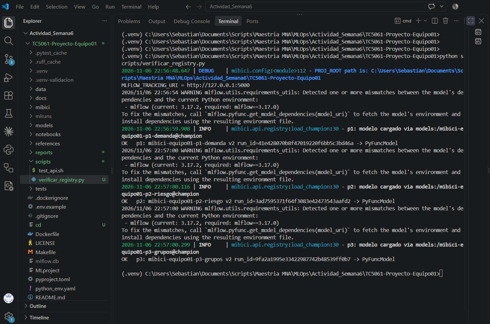
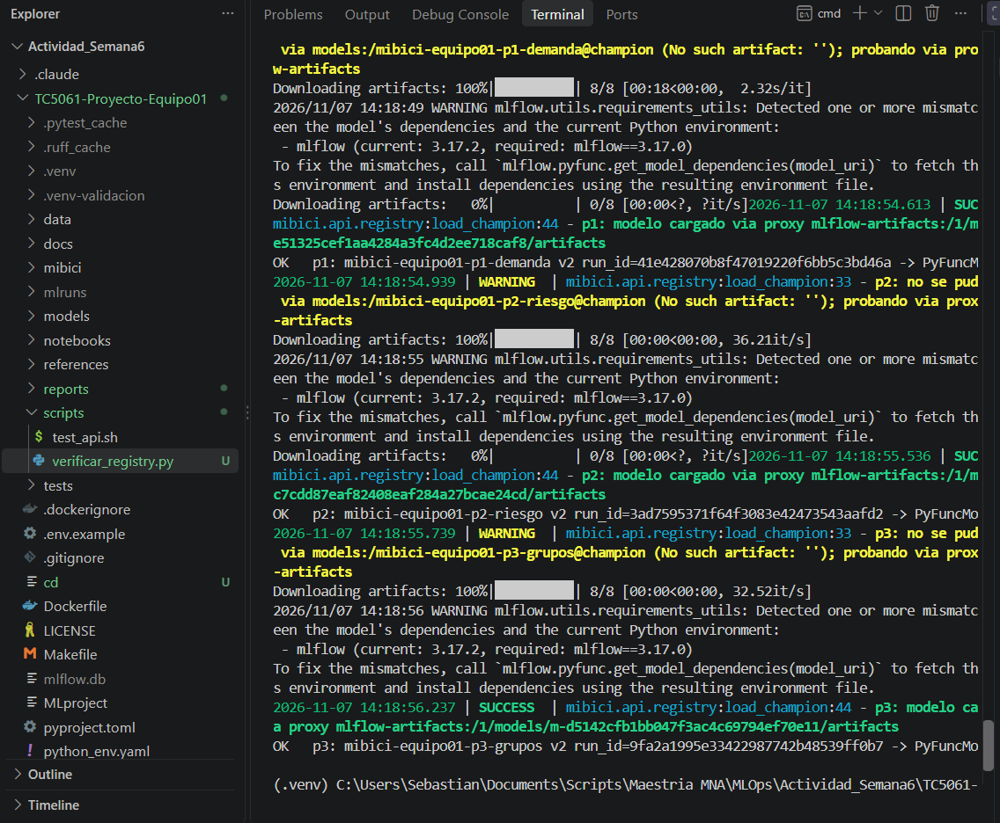
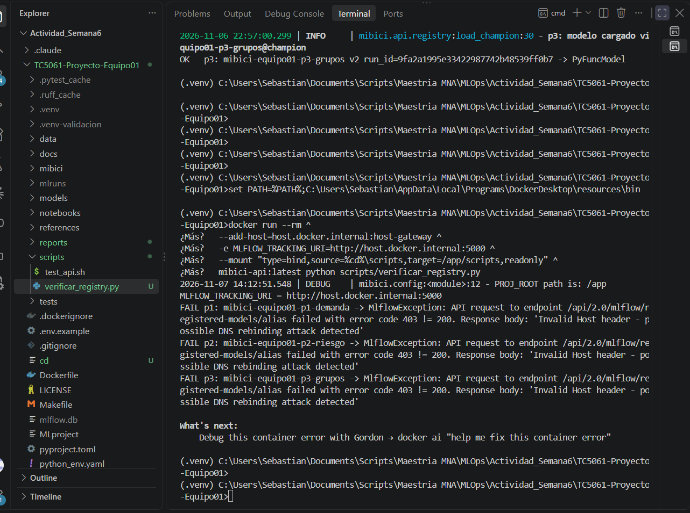
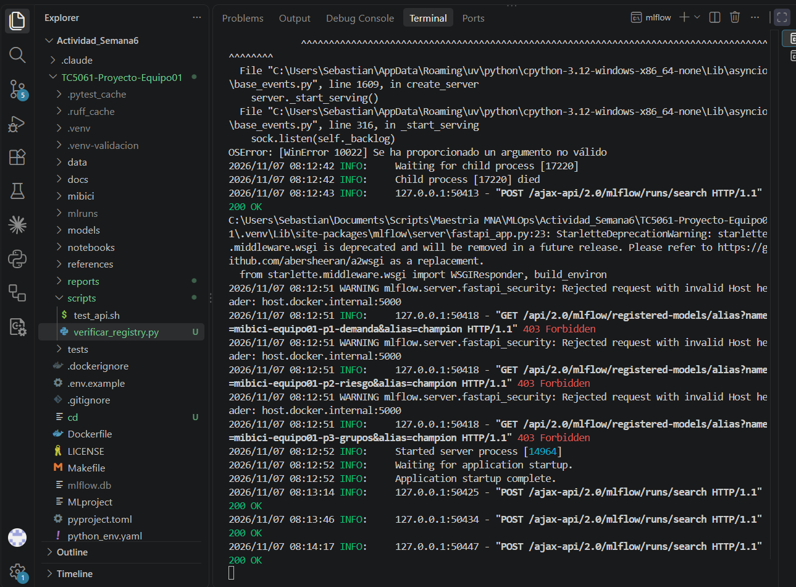

# Evidencia: conexión del contenedor con el servidor MLflow

Validación de que un contenedor Docker alcanza el servidor MLflow de la máquina anfitriona y carga desde el Model Registry los tres modelos con alias `@champion`.

## Entorno

- Host: Windows 10 Pro (19045), Docker Desktop 29.9.2 (backend WSL 2)
- Imagen: `mibici-api:latest` (python:3.12-slim), construida con `docker build -t mibici-api:latest .` en 218 s
- Servidor MLflow lanzado desde la raíz del repo:

```cmd
set MLFLOW_SERVER_ALLOWED_HOSTS=localhost:5000,127.0.0.1:5000,host.docker.internal:5000
mlflow server --backend-store-uri sqlite:///mlflow.db --artifacts-destination ./mlruns --port 5000
```

## 1. El servidor responde en el host

```text
> curl.exe http://127.0.0.1:5000/health
OK
> curl.exe -H "Host: host.docker.internal:5000" http://127.0.0.1:5000/health
OK
```

El segundo comando simula el `Host` con el que llegan las peticiones del contenedor.

## 2. Carga desde el host

```cmd
set MLFLOW_TRACKING_URI=http://127.0.0.1:5000
python scripts/verificar_registry.py
```

```text
MLFLOW_TRACKING_URI = http://127.0.0.1:5000
INFO     | p1: modelo cargado via models:/mibici-equipo01-p1-demanda@champion
OK   p1: mibici-equipo01-p1-demanda v2 run_id=41e428070b8f47019220f6bb5c3bd46a -> PyFuncModel
INFO     | p2: modelo cargado via models:/mibici-equipo01-p2-riesgo@champion
OK   p2: mibici-equipo01-p2-riesgo v2 run_id=3ad7595371f64f3083e42473543aafd2 -> PyFuncModel
INFO     | p3: modelo cargado via models:/mibici-equipo01-p3-grupos@champion
OK   p3: mibici-equipo01-p3-grupos v2 run_id=9fa2a1995e33422987742b48539ff0b7 -> PyFuncModel
```



En el host, `models:/<nombre>@champion` carga directo, porque la ruta local de los artefactos sí existe.

## 3. Carga desde el contenedor

```cmd
docker run --rm ^
  --add-host=host.docker.internal:host-gateway ^
  -e MLFLOW_TRACKING_URI=http://host.docker.internal:5000 ^
  --mount "type=bind,source=%cd%\scripts,target=/app/scripts,readonly" ^
  mibici-api:latest python scripts/verificar_registry.py
```

```text
MLFLOW_TRACKING_URI = http://host.docker.internal:5000
WARNING  | p1: no se pudo cargar via models:/mibici-equipo01-p1-demanda@champion (No such artifact: ''); probando via proxy mlflow-artifacts
SUCCESS  | p1: modelo cargado via proxy mlflow-artifacts:/1/models/m-e51325cef1aa4284a3fc4d2ee718caf8/artifacts
OK   p1: mibici-equipo01-p1-demanda v2 run_id=41e428070b8f47019220f6bb5c3bd46a -> PyFuncModel
WARNING  | p2: no se pudo cargar via models:/mibici-equipo01-p2-riesgo@champion (No such artifact: ''); probando via proxy mlflow-artifacts
SUCCESS  | p2: modelo cargado via proxy mlflow-artifacts:/1/models/m-c7cdd87eaf82408eaf284a27bcae24cd/artifacts
OK   p2: mibici-equipo01-p2-riesgo v2 run_id=3ad7595371f64f3083e42473543aafd2 -> PyFuncModel
WARNING  | p3: no se pudo cargar via models:/mibici-equipo01-p3-grupos@champion (No such artifact: ''); probando via proxy mlflow-artifacts
SUCCESS  | p3: modelo cargado via proxy mlflow-artifacts:/1/models/m-d5142cfb1bb047f3ac4c69794ef70e11/artifacts
OK   p3: mibici-equipo01-p3-grupos v2 run_id=9fa2a1995e33422987742b48539ff0b7 -> PyFuncModel
```

Salida resumida: se quitaron las barras de descarga y el aviso de versión de mlflow, que se explica abajo.

- Dentro del contenedor, `models:/...` falla con `No such artifact: ''`, porque el `artifact_uri` guardado es una ruta de Windows del host. `mibici/api/registry.py` resuelve entonces el alias y descarga los artefactos por el proxy `mlflow-artifacts:/`, que solo funciona si el servidor se lanzó con `--artifacts-destination`.
- Los tres modelos cargan en la versión 2, con los mismos `run_id` que en el host.
- El aviso `mlflow (current: 3.17.2, required: mlflow==3.17.0)` aparece porque los modelos se registraron con 3.17.0 y después el proyecto subió a 3.17.2 por un CVE. Es un cambio de parche y no afecta la carga.



## 4. Prueba negativa: servidor sin `MLFLOW_SERVER_ALLOWED_HOSTS`

Mismo `docker run`, con el servidor lanzado sin la variable:

```text
MLFLOW_TRACKING_URI = http://host.docker.internal:5000
FAIL p1: mibici-equipo01-p1-demanda -> MlflowException: API request to endpoint /api/2.0/mlflow/registered-models/alias failed with error code 403 != 200. Response body: 'Invalid Host header - possible DNS rebinding attack detected'
FAIL p2: mibici-equipo01-p2-riesgo -> MlflowException: API request to endpoint /api/2.0/mlflow/registered-models/alias failed with error code 403 != 200. Response body: 'Invalid Host header - possible DNS rebinding attack detected'
FAIL p3: mibici-equipo01-p3-grupos -> MlflowException: API request to endpoint /api/2.0/mlflow/registered-models/alias failed with error code 403 != 200. Response body: 'Invalid Host header - possible DNS rebinding attack detected'
```



Del lado del servidor, el log registra cada rechazo:

```text
WARNING mlflow.server.fastapi_security: Rejected request with invalid Host header: host.docker.internal:5000
INFO:   127.0.0.1:50418 - "GET /api/2.0/mlflow/registered-models/alias?name=mibici-equipo01-p1-demanda&alias=champion HTTP/1.1" 403 Forbidden
```



Esto confirma que la variable es obligatoria: sin ella, el servidor rechaza al contenedor desde la primera petición.

## Conclusión

| Requisito | Resultado |
|---|---|
| Servidor accesible en el host (puerto 5000) | OK |
| `MLFLOW_TRACKING_URI=http://host.docker.internal:5000` dentro del contenedor | OK, los 3 modelos cargan |
| `host.docker.internal` en Windows (Docker Desktop) | Resuelve sin configuración extra |
| Linux | Requiere `--add-host=host.docker.internal:host-gateway` (agregado al `make docker-run`) |
| `MLFLOW_SERVER_ALLOWED_HOSTS` | Obligatoria: sin ella responde `403` |
| `--artifacts-destination ./mlruns` | Obligatorio para la descarga por proxy |
