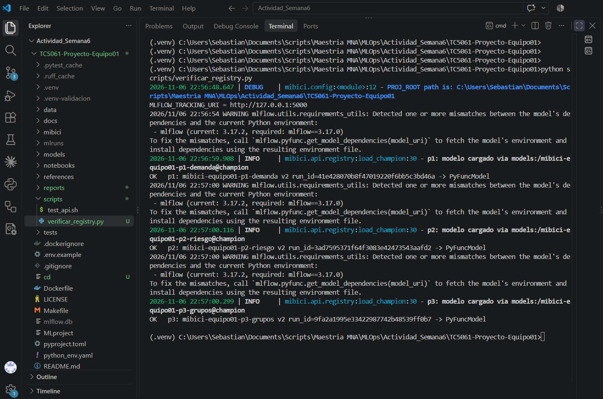
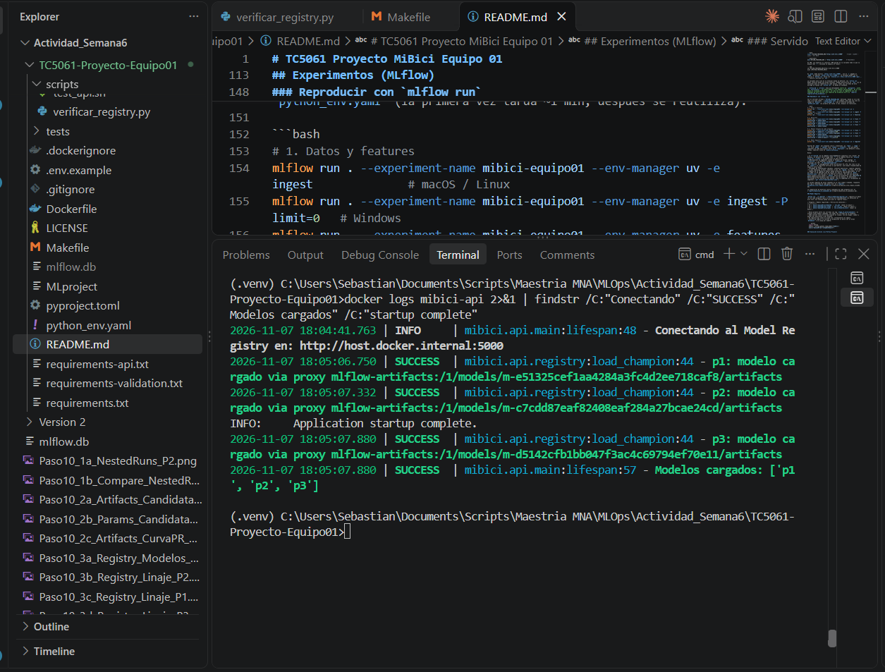
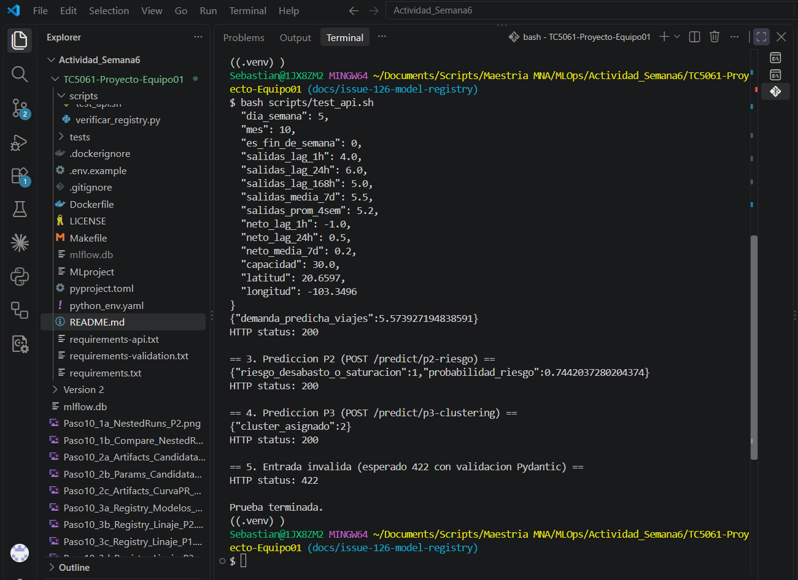
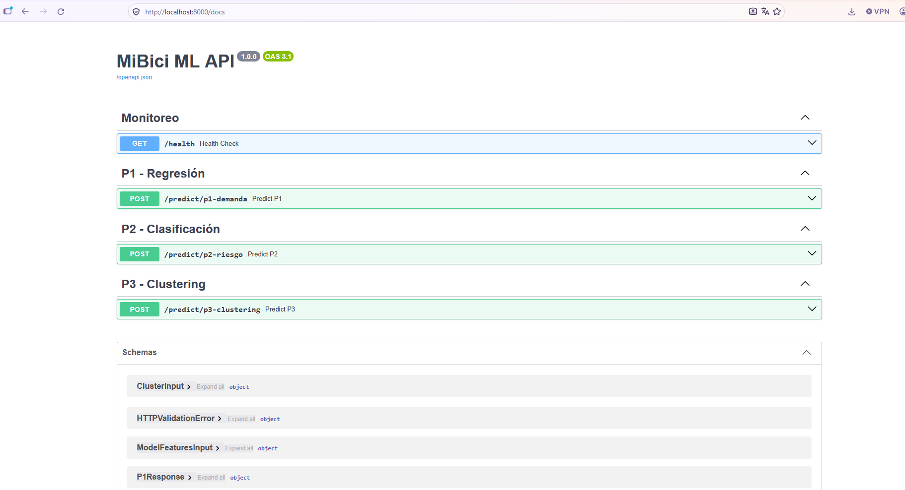

# Evidencia: recuperación de los modelos desde el Model Registry

Validación de que los tres modelos del proyecto se recuperan del Model Registry por nombre y alias `@champion`, y de que la API los integra y responde sin errores dentro del contenedor.

## Modelos desplegados

| Pregunta | Modelo registrado | Versión `@champion` | Run de origen | run_id |
|---|---|---|---|---|
| P1 | `mibici-equipo01-p1-demanda` | 2 | `p1-candidate-rf-n200` | `41e428070b8f47019220f6bb5c3bd46a` |
| P2 | `mibici-equipo01-p2-riesgo` | 2 | `P2-parent-search-logreg` (C=1.0) | `3ad7595371f64f3083e42473543aafd2` |
| P3 | `mibici-equipo01-p3-grupos` | 2 | `p3-candidate-k3` | `9fa2a1995e33422987742b48539ff0b7` |

Se despliegan los tres porque la API expone un endpoint por pregunta.

**Ubicación del registry:** servidor MLflow en la máquina anfitriona (`mlflow.db` y `mlruns/`), lanzado con `MLFLOW_SERVER_ALLOWED_HOSTS` y `--artifacts-destination ./mlruns`. La imagen no lleva modelos: los descarga del registry al arrancar. La configuración del servidor y la conexión desde el contenedor están en [`evidencia_conexion_contenedor.md`](evidencia_conexion_contenedor.md).

## 1. Carga desde el host con `mlflow.pyfunc.load_model`

```cmd
set MLFLOW_TRACKING_URI=http://127.0.0.1:5000
python scripts/verificar_registry.py
```

```text
MLFLOW_TRACKING_URI = http://127.0.0.1:5000
INFO     | p1: modelo cargado via models:/mibici-equipo01-p1-demanda@champion
OK   p1: mibici-equipo01-p1-demanda v2 run_id=41e428070b8f47019220f6bb5c3bd46a -> PyFuncModel
INFO     | p2: modelo cargado via models:/mibici-equipo01-p2-riesgo@champion
OK   p2: mibici-equipo01-p2-riesgo v2 run_id=3ad7595371f64f3083e42473543aafd2 -> PyFuncModel
INFO     | p3: modelo cargado via models:/mibici-equipo01-p3-grupos@champion
OK   p3: mibici-equipo01-p3-grupos v2 run_id=9fa2a1995e33422987742b48539ff0b7 -> PyFuncModel
```



`load_champion` llama a `mlflow.pyfunc.load_model("models:/<nombre>@champion")`. El script además resuelve el alias con `MlflowClient().get_model_version_by_alias`, que confirma la versión y el run de origen.

## 2. La API carga los modelos al arrancar en el contenedor

```cmd
docker run -d --rm -p 8000:8000 --name mibici-api ^
  --add-host=host.docker.internal:host-gateway ^
  -e MLFLOW_TRACKING_URI=http://host.docker.internal:5000 ^
  mibici-api:latest
docker logs mibici-api 2>&1 | findstr /C:"Conectando" /C:"SUCCESS" /C:"Modelos cargados" /C:"startup complete"
```

```text
INFO     | mibici.api.main:lifespan:48 - Conectando al Model Registry en: http://host.docker.internal:5000
SUCCESS  | mibici.api.registry:load_champion:44 - p1: modelo cargado via proxy mlflow-artifacts:/1/models/m-e51325cef1aa4284a3fc4d2ee718caf8/artifacts
SUCCESS  | mibici.api.registry:load_champion:44 - p2: modelo cargado via proxy mlflow-artifacts:/1/models/m-c7cdd87eaf82408eaf284a27bcae24cd/artifacts
SUCCESS  | mibici.api.registry:load_champion:44 - p3: modelo cargado via proxy mlflow-artifacts:/1/models/m-d5142cfb1bb047f3ac4c69794ef70e11/artifacts
SUCCESS  | mibici.api.main:lifespan:57 - Modelos cargados: ['p1', 'p2', 'p3']
INFO:     Application startup complete.
```



Los identificadores `m-…` del proxy son los logged models de la versión 2 de cada modelo registrado.

## 3. La API responde con los modelos integrados

Desde Git Bash, con el contenedor arriba:

```bash
bash scripts/test_api.sh
```

```text
== 1. Health check (GET /health) ==
{"status":"healthy","modelos_cargados":["p1","p2","p3"]}
HTTP status: 200

== 2. Prediccion P1 (POST /predict/p1-demanda) ==
{"demanda_predicha_viajes":5.573927194838591}
HTTP status: 200

== 3. Prediccion P2 (POST /predict/p2-riesgo) ==
{"riesgo_desabasto_o_saturacion":1,"probabilidad_riesgo":0.7442037280204374}
HTTP status: 200

== 4. Prediccion P3 (POST /predict/p3-clustering) ==
{"cluster_asignado":2}
HTTP status: 200

== 5. Entrada invalida (esperado 422 con validacion Pydantic) ==
HTTP status: 422
```

Salida resumida: se omite el payload de 15 features que imprime el script (está en `scripts/test_api.sh`).





## Conclusión

| Criterio | Resultado |
|---|---|
| Recuperar el modelo con nombre y versión correctos | OK: los 3 modelos se cargan por `models:/<nombre>@champion` y resuelven la versión 2 |
| Integración en la API sin errores | OK: `/health` 200 con los 3 modelos, predicciones 200 en P1, P2 y P3, y 422 ante entrada inválida |

**Nota:** la versión 2 se registró antes de que `register` eligiera por métricas de validación, así que sus runs solo tienen métricas `test_*`. Si se vuelve a correr `-e register`, el alias puede moverse a una versión 3. En ese caso, esta tabla se actualiza con `scripts/verificar_registry.py`.
