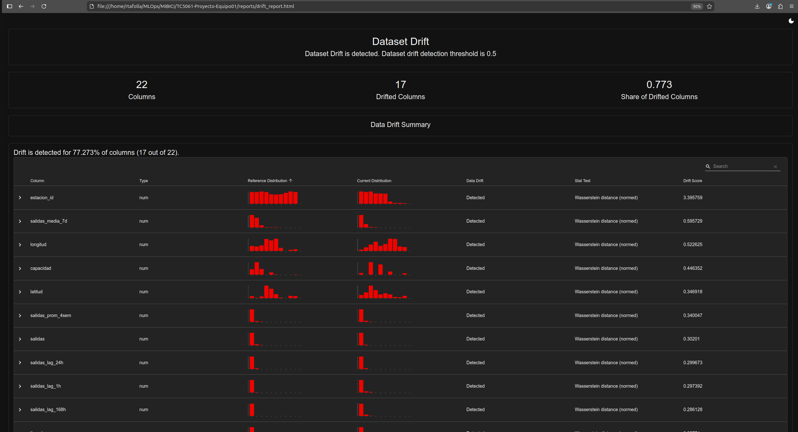
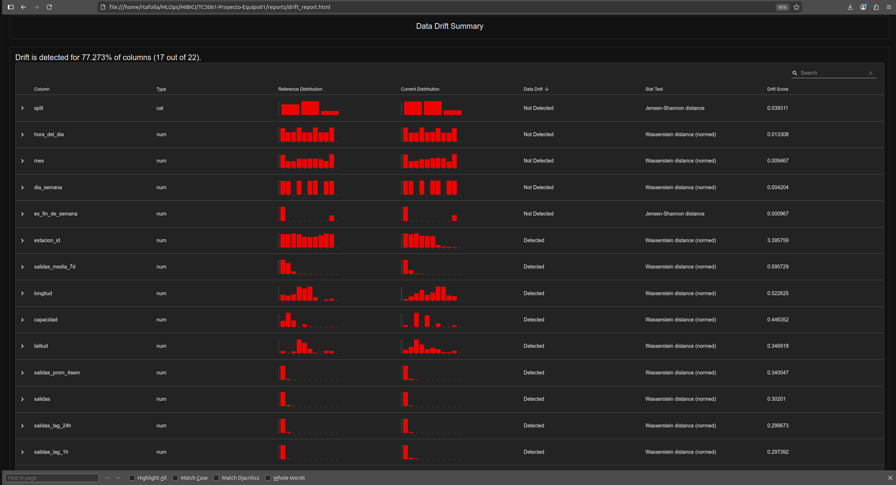
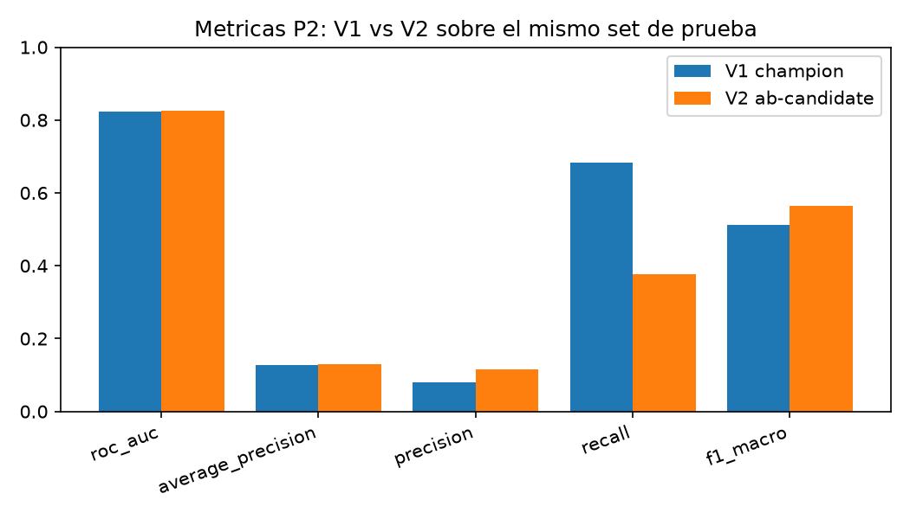
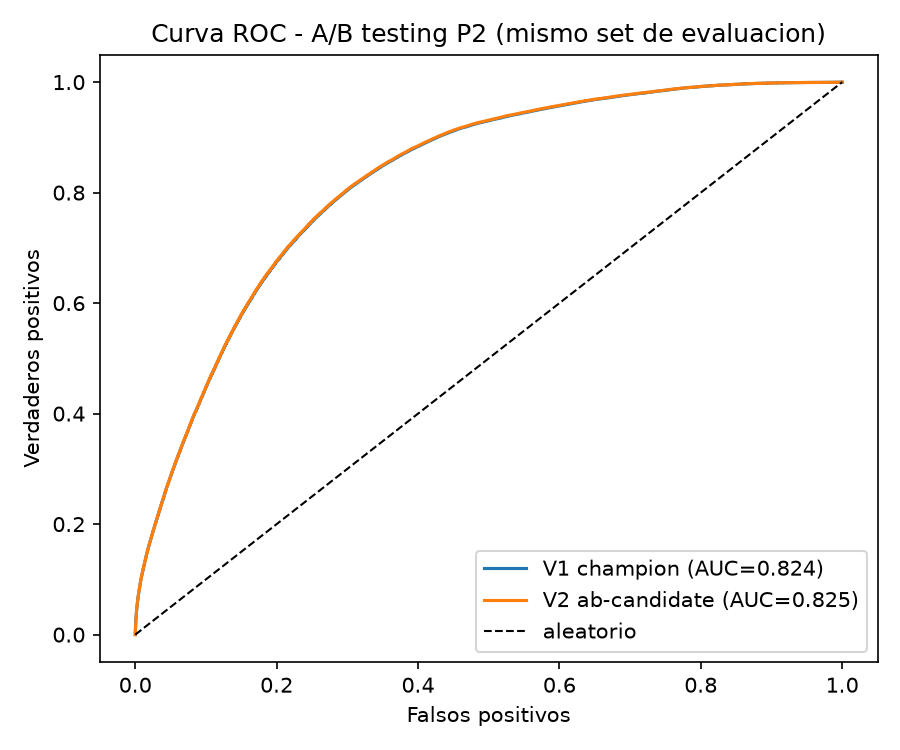

# Actividad 9: Monitoreo de drift, A/B testing y Continuous Training

Equipo 01 · TC5061 MLOps · Proyecto MiBici

Este documento reúne los tres resultados de la actividad: el reporte de drift y calidad de datos, la comparación A/B entre dos versiones del modelo P2 (Riesgo) y la recomendación sobre Continuous Training. Se puede leer sin abrir el HTML de Evidently.

| Resultado | Cómo se reproduce | Archivos |
|---|---|---|
| Drift y calidad de datos | `mlflow run . -e drift --env-manager=uv` | `reports/drift_report.html`, `reports/drift_report.json` |
| A/B testing P2 | `mlflow run . -e ab_test --env-manager=uv` | `reports/ab_testing_p2.md`, `reports/ab_testing_p2.csv`, `reports/figures/ab_testing_p2/` |

---

## 1. Reporte de data drift y calidad de datos

### 1.1 Conjuntos comparados

Los dos conjuntos salen de `data/processed/features_estacion_hora.parquet` y se separan **por fecha**, no por posición, para que ninguna hora del periodo actual entre en la referencia:

| Conjunto | Periodo | Por qué |
|---|---|---|
| Referencia | 2023-05-01 a 2024-12-31 | Es la ventana con la que se entrenaron los modelos vigentes (`config.TRAIN_END`). Representa lo que el modelo "conoce". |
| Actual | 2025-01-01 a 2026-09-30 | Periodo posterior que el modelo no vio al entrenar. Simula los datos que llegan en producción. |

De cada conjunto se toma una muestra de 30,000 filas con `config.SEED = 42` para que el reporte quepa en memoria y sea reproducible. Evidently usa la distancia de Wasserstein normalizada en las variables numéricas y la distancia de Jensen-Shannon en `es_fin_de_semana`. El umbral es 0.1 por variable, y el dataset se marca con drift si al menos el 50 % de las columnas lo tiene.

### 1.2 Resultado general

- Variables analizadas: 21
- Variables con drift: **4 (19 %)**
- Drift a nivel dataset: **no** (el criterio es 50 % de las columnas)

### 1.3 Variables con drift

| Variable | Distancia (Wasserstein normalizada) | Lectura |
|---|---:|---|
| `mes` | **0.4157** | Se debe sobre todo a las ventanas elegidas. La referencia cubre mayo a diciembre dos veces (2023 y 2024) y enero a abril una vez; la actual cubre enero a septiembre dos veces y octubre a diciembre una vez. Gran parte del drift es de calendario, no un cambio de comportamiento. |
| `estacion_id` | **0.2367** | Cambió la mezcla de estaciones que aparecen en la muestra: altas y bajas de estaciones y redistribución del uso dentro de la red. |
| `salidas_media_7d` | **0.1379** | El nivel de demanda semanal por estación se movió. Es la variable de mayor peso para predecir demanda (P1) y riesgo (P2). |
| `neto_media_7d` | **0.1288** | Cambió el balance semanal llegadas − salidas por estación, que es la base de la etiqueta de riesgo de P2. |

Las demás 17 variables quedan por debajo de 0.1. Las más altas son `salidas_prom_4sem` (0.078) y `salidas_lag_1h` (0.070). Las variables de hora y día (`hora_del_dia` 0.014, `dia_semana` 0.006, `es_fin_de_semana` 0.002) prácticamente no cambian: el patrón diario y semanal de uso es estable.

### 1.4 Calidad de datos

| Indicador | Referencia | Actual |
|---|---:|---:|
| Filas (muestra) | 30,000 | 30,000 |
| Columnas | 21 | 21 |
| Valores faltantes | 4,776 | 1,189 |
| Filas duplicadas | 0 | 4 |
| Columnas constantes o vacías | 0 | 0 |

Los faltantes del periodo actual se concentran en los rezagos y promedios móviles (`salidas_prom_4sem`, `neto_prom_4sem`: 358; `*_lag_168h`, `*_media_7d`: 90), que no existen en las primeras horas de cada estación, y en `capacidad`, `latitud` y `longitud` (33), que vienen de estaciones sin registro en la nomenclatura. La referencia tiene más faltantes porque incluye el arranque de la serie en mayo de 2023, cuando todavía no hay historia para calcular rezagos. Los 4 duplicados del periodo actual no afectan al análisis.

---

## 2. A/B testing del modelo P2 (Riesgo)

### 2.1 Versiones comparadas

Las dos versiones están registradas bajo el **mismo nombre** en el Model Registry, `mibici-equipo01-p2-riesgo`:

| | Versión | Alias | Entrenamiento | Umbral |
|---|---|---|---|---:|
| V1 | 2 | `@champion` | Ventana original (train hasta 2024-12) | 0.50 |
| V2 | 4 | `@ab-candidate` | Ventana extendida 2023-05-01 a 2025-06-30 | 0.70 |

La V2 se registró con el alias `ab-candidate` y el tag `stage_of_work=ab_candidate`. Así el alias `champion` no se mueve solo y `register.py` no la promueve por accidente.

### 2.2 Metodología

1. **Un solo conjunto de evaluación.** Las dos versiones se evalúan sobre las mismas 4,231,300 filas del split `test` (2025-07-01 a 2026-09-30, 2.56 % de horas en riesgo), con las mismas features, la misma etiqueta y la misma semilla (42). La única variable del experimento es el modelo.
2. **Sin fuga de información.** La V2 se entrenó solo hasta 2025-06-30, y su `C` y su umbral se eligieron en un holdout interno (2025-04-01 a 2025-06-30). Ninguna fila del set de evaluación participó en el entrenamiento ni en la selección de hiperparámetros de ninguna de las dos versiones.
3. **Métricas.** ROC AUC y average precision miden la calidad del ranking y no dependen del umbral. Precisión, recall y F1 macro se calculan con el umbral propio de cada versión, como operaría en producción. F1 macro es la métrica principal porque la clase en riesgo es muy minoritaria.
4. **Significancia.** La diferencia de aciertos se prueba con el test exacto de McNemar sobre los pares discordantes. Es la prueba adecuada para dos clasificadores evaluados sobre las mismas observaciones.
5. **Control del umbral.** Además se evalúa cada modelo con el umbral del otro, para separar el efecto del reentrenamiento del efecto del corte.

> Nota: el set del A/B (desde 2025-07) es un subconjunto del periodo "actual" del drift (desde 2025-01). Los meses de enero a junio de 2025 quedan dentro del entrenamiento de la V2, que es justamente lo que se busca: un modelo que ya vio parte de la distribución nueva.

### 2.3 Tabla comparativa

| Métrica | V1 (champion) | V2 (ab-candidate) | Δ (V2 − V1) |
|---|---:|---:|---:|
| ROC AUC | 0.8239 | 0.8248 | +0.0008 |
| Average precision | 0.1283 | 0.1287 | +0.0005 |
| Precisión | 0.0805 | 0.1144 | +0.0339 |
| Recall | 0.6819 | 0.3773 | −0.3046 |
| **F1 macro** | 0.5129 | **0.5638** | **+0.0509** |

**McNemar:** 32,983 pares en los que solo acierta V1 frente a 527,409 en los que solo acierta V2; p < 0.0001.

### 2.4 Sensibilidad al umbral

| Configuración | Umbral | F1 macro |
|---|---:|---:|
| V1 con su umbral | 0.50 | 0.5129 |
| V2 con su umbral | 0.70 | 0.5638 |
| V1 con el umbral de la V2 | 0.70 | 0.5640 |
| V2 con el umbral de la V1 | 0.50 | 0.5123 |

### 2.5 Conclusión del A/B

La V2 gana como se desplegaría (F1 macro +0.051, diferencia significativa), pero **la mejora viene del umbral, no del reentrenamiento**. Con el mismo umbral los dos modelos empatan, y el ROC AUC casi no cambia (+0.0008). Reentrenar con la ventana extendida no mejoró la capacidad del modelo para ordenar las horas de riesgo.

Detalle completo en [`ab_testing_p2.md`](ab_testing_p2.md).

---

## 3. Recomendación de Continuous Training

### 3.1 Implicaciones por variable con drift en P1 y P2

De las 21 variables monitoreadas mediante Evidently, cuatro (19.05 %) superaron el umbral de detección de 0.10. El reporte utiliza principalmente la distancia de Wasserstein normalizada para comparar las distribuciones de referencia y actuales. Estos resultados indican cambios en las variables, pero no demuestran por sí solos una degradación del desempeño predictivo.

| Variable | Distancia de Wasserstein | Umbral | Implicación para P1 y P2 |
|---|---:|---:|---|
| `mes` | **0.4157** | 0.10 | Presenta el mayor desplazamiento. Puede estar relacionado con las diferencias en la cobertura temporal de ambos periodos. Es una variable categórica de calendario utilizada en los modelos, por lo que conviene revisar su distribución mensual y considerar su naturaleza cíclica. |
| `estacion_id` | **0.2367** | 0.10 | Cambió la distribución de identificadores: 369 valores únicos en referencia frente a 473 en el periodo actual. Es importante para segmentar los registros por estación y construir las variables históricas, aunque no forma parte directamente del conjunto de predictores de P1 y P2. |
| `salidas_media_7d` | **0.1379** | 0.10 | Refleja cambios en el promedio móvil de salidas de los últimos siete días. Es una variable utilizada por ambos modelos y su desplazamiento puede afectar las predicciones de demanda de P1 y las estimaciones de riesgo de P2. |
| `neto_media_7d` | **0.1288** | 0.10 | Representa el promedio móvil del saldo neto de viajes. Su cambio puede modificar la información histórica utilizada por P1 y P2. En P2 resulta relevante porque el modelo estima riesgos de vaciado o saturación utilizando variables históricas, aunque su etiqueta se construye a partir del saldo neto futuro. |

### 3.2 Interpretación estadística del desplazamiento

- **Ausencia de drift global:** Evidently identifica cuatro variables con drift de un total de 21 (19.05 %). El resultado global es `dataset_drift = false`, debido a que no se alcanza el umbral configurado del 50 % de variables afectadas.

- **Cambios temporales:** `mes` presenta una distancia de 0.4157, considerablemente superior al resto de las variables. Parte de esta diferencia puede relacionarse con la composición temporal de los conjuntos de referencia y actual. Por ello, es necesario considerar la distribución de los meses antes de atribuir el resultado a un cambio estructural en la demanda.

- **Cambios en la red y movilidad:** el desplazamiento de `estacion_id` indica diferencias en la composición de los identificadores observados. Por otro lado, los cambios en `salidas_media_7d` y `neto_media_7d` sugieren variaciones en los patrones recientes de movilidad.

- **Ausencia de evidencia de concept drift:** el reporte identifica cambios en las distribuciones de entrada (data drift o covariate shift), pero no evalúa directamente si cambió la relación entre las variables predictoras y las etiquetas. Para demostrar concept drift sería necesario analizar la relación entre las predicciones y los resultados reales a lo largo del tiempo.

- **Calidad de datos:** el conjunto de referencia presenta 4,776 valores faltantes, mientras que el actual presenta 1,189. También se identifican cuatro filas duplicadas en el conjunto actual frente a ninguna en el de referencia. Estos resultados muestran que la calidad de datos debe monitorearse de forma independiente al drift.

### 3.3 Cruce de resultados: Drift y A/B Testing

El experimento A/B compara P2 V1 (`@champion`) y V2 (`@ab-candidate`) sobre las mismas 4,231,300 observaciones del periodo julio de 2025 a septiembre de 2026.

El ROC AUC pasó de 0.8239 en V1 a 0.8248 en V2 (Δ = +0.0008), lo que representa una variación marginal en la capacidad de ordenar las observaciones según su riesgo.

Aunque V2 obtuvo un F1 macro de 0.5638 frente a 0.5129 de V1, la evaluación de sensibilidad al umbral muestra que:

- V1 con umbral 0.70 obtiene F1 macro de 0.5640.
- V2 con umbral 0.70 obtiene F1 macro de 0.5638.

Por lo tanto, la mejora observada al comparar las versiones con sus respectivos umbrales no demuestra que el reentrenamiento haya generado una mejor capacidad discriminativa. La diferencia se explica principalmente por el ajuste del umbral de clasificación.

El test exacto de McNemar obtuvo `p < 0.0001`, lo que indica diferencias estadísticamente significativas en los resultados de clasificación pareada de ambos modelos. Sin embargo, este resultado no demuestra por sí solo que exista una mejora significativa del F1 macro atribuible al reentrenamiento.

**Insumos que cruza la recomendación:**

- **Drift:** el 19 % de las variables tiene drift, sin drift a nivel dataset. El cambio de `mes` es en buena parte un efecto de las ventanas elegidas. Las otras variables con drift detectado son `estacion_id`, `salidas_media_7d` y `neto_media_7d`.
- **A/B:** reentrenar con datos más recientes no mejora el ranking (ΔROC AUC +0.0008). La ganancia práctica sale de recalibrar el umbral.

### 3.4 Veredicto y justificación de negocio

**Veredicto: No activar Continuous Training de forma automática en este ciclo.**

La recomendación es conservar el modelo `@champion` mientras se mantiene el monitoreo de las variables con drift y se evalúan periódicamente las métricas de desempeño sobre datos recientes.

La decisión se fundamenta en tres observaciones:

1. **Drift localizado:** cuatro de las 21 variables presentan desplazamientos superiores al umbral individual, pero no existe drift global según el criterio configurado por Evidently. Esto justifica investigar los cambios, pero no constituye evidencia suficiente para ordenar un reentrenamiento completo.

2. **Ausencia de mejora demostrada por reentrenamiento:** el ROC AUC de V2 presenta una variación mínima frente a V1. Además, la sensibilidad al umbral indica que la mejora de F1 macro puede obtenerse ajustando el punto de corte de V1, sin necesidad de sustituir el modelo.

3. **Consideración operativa:** el cambio de umbral de 0.50 a 0.70 aumenta la precisión, pero reduce considerablemente el recall. Por ello, su implementación requiere evaluar el costo de los falsos negativos y falsos positivos antes de modificar la operación.

**Propuesta de monitoreo y activación futura:**

- Dar seguimiento a `mes`, `estacion_id`, `salidas_media_7d` y `neto_media_7d`.
- Revisar periódicamente ROC AUC, precision, recall y F1 macro con etiquetas reales recientes.
- Evaluar cambios en la distribución de las etiquetas y en la relación entre predicciones y resultados observados.
- Considerar Continuous Training cuando se identifique una degradación persistente del desempeño predictivo y la nueva versión demuestre mejoras en una evaluación comparable.
- Validar cualquier cambio de umbral considerando el equilibrio entre detección de riesgos y falsas alertas.

La decisión de activar Continuous Training debe depender de evidencia conjunta de cambios en los datos y degradación del modelo, no únicamente de la detección de drift en algunas variables.
